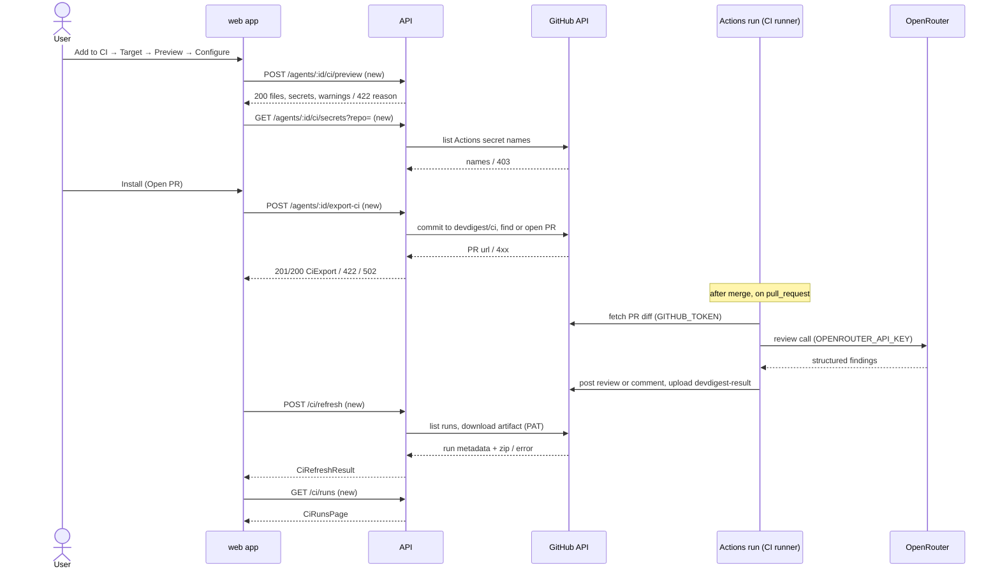

# Spec: Export to CI — review agents in GitHub Actions, CI tab, CI Runs

Spec ID: SPEC-07
Status: implemented
Created: 2026-10-12
Approved: 2026-10-12 by user
Modules: client · server · agent-runner (consumes reviewer-core unchanged)
Supersedes: none
Superseded by: none

## Problem and user

**User:** a DevDigest user who has tuned a review agent in the studio (prompt,
skills, CI gate) and wants the same agent to review every pull request of a
GitHub repository automatically, without the studio running, and to block merges
on CRITICAL findings.

**Today:**
- The agent runs only locally. There is no server `ci` module: no route under
  `server/src/modules/*/routes.ts` exports an agent, although the bundled runner
  already refers to one (`agent-runner/src/index.ts:5-6`,
  `agent-runner/src/context.ts:9`, `agent-runner/src/manifest.ts:10`).
- The CI runner exists. It loads a manifest and skills, fetches the PR diff, runs
  `reviewPullRequest` with the mandatory grounding gate, computes the verdict from
  `ci_fail_on`, writes `devdigest-result.json`, posts the result and sets the exit
  code (`agent-runner/src/run.ts:83-173`). Its bundle `dist/` is git-ignored
  (`agent-runner/README.md:80-81`).
- Contracts and tables exist without behaviour behind them: `CiTarget`,
  `CiExportInput`, `CiInstallation`, `CiExport`, `CiRun` and `CiResultArtifact`
  (`server/src/vendor/shared/contracts/eval-ci.ts:294-400`), plus
  `ci_installations` and `ci_runs` (`server/src/db/schema/ci.ts:4-26`).
  `agent_runs.source` accepts `ci` (`server/src/db/schema/runs.ts:26`).
- The agent editor has no CI tab (`client/src/app/agents/[id]/_components/AgentEditor/constants.ts:13-18`).
  There is no `/ci-runs` page; only a sidebar key exists
  (`client/src/components/app-shell/helpers.ts:38`) plus i18n strings
  (`client/messages/en/ci.json`).
- The gate value is already editable as "CI gate" in the Config tab
  (`client/src/app/agents/[id]/_components/AgentEditor/_components/ConfigTab/ConfigTab.tsx:118-122`),
  stored as `agents.ci_fail_on` (`server/src/db/schema/agents.ts:25-27`). Nothing
  carries it into a repository.
- The artifact has no commit SHA, repository identity, run identity, verdict or
  blocker count (`server/src/vendor/shared/contracts/eval-ci.ts:389-399`). Its
  origin therefore cannot be verified.
- The API listens without authentication (`server/src/server.ts:36`; default
  `LocalNoAuthProvider`, `server/INSIGHTS.md:25`). A runner hosted on GitHub
  cannot reach a local-first API, so results have to be **pulled** from GitHub.

## Terms

- **CI runner:** the bundled `agent-runner` script that the generated workflow
  executes. In this root spec it is part of the subject **DevDigest**. Every
  `DevDigest shall` row below describes CI-runner or generated-workflow
  behaviour, observed in the target repository's GitHub Actions run.
- **Installation:** one agent exported to one repository (`owner/name`), at most
  one agent per repository.
- **Export PR:** the pull request DevDigest opens from branch `devdigest/ci`.
- **Result artifact:** the GitHub Actions artifact named `devdigest-result`. It
  contains `devdigest-result.json` (the review result) and `devdigest-run.json`
  (the run metadata sidecar).
- **Verdict:** the deterministic review event `approve | comment | request_changes`.
  It is `approve` when there are no grounded findings, `request_changes` when the
  gate triggers, and `comment` otherwise (`reviewer-core/src/output/to-review.ts:154-161`).
- **Gate / Fail CI on:** `agents.ci_fail_on` (`never | critical | warning | any`,
  `server/src/vendor/shared/contracts/knowledge.ts:303-310`). The gate triggers
  when ≥ 1 grounded finding has a severity rank ≥ the policy minimum
  (`reviewer-core/src/output/to-review.ts:26-40`).
- **Workflow version:** the first 12 hex characters of the SHA-256 of the
  workflow file content as exported (after user edits).
- **Generator version:** an integer the API stamps on every export. It increases
  whenever the generated file set changes shape.
- **Credential-shaped string:** text that equals the value of any secret stored
  in the workspace's secrets file, or that matches one of these patterns (the
  reference implementation's list, FF `server/src/modules/ci/redact.ts`):
  - `\bsk-[A-Za-z0-9]{16,}\b`
  - `\bghp_[A-Za-z0-9]{36,}\b`
  - `\bgithub_pat_[A-Za-z0-9_]{20,}\b`
  - `\bAKIA[0-9A-Z]{16}\b`
  - `-----BEGIN [A-Z ]*PRIVATE KEY-----`
  - `(?:key|token|secret)\s*[:=]\s*["']?[A-Za-z0-9+/_-]{24,}={0,2}["']?` (case-insensitive)

  The scan covers every generated file, including the runner bundle. The
  `security` skill's looser generic pattern is deliberately not used (see
  Assumptions).
- **Bootstrap guard:** the first step after the base-commit checkout in the generated job. It checks whether the
  base-commit checkout contains `.devdigest/runner/index.js`.
- **Refresh:** one pull-ingest pass over the workspace's installations.
  *Forced* refresh ignores the per-installation debounce.

## Goals / Non-goals

**Goals**
| ID | Goal | Success measure |
|---|---|---|
| G-1 | Export an agent to a GitHub repository without hand-writing CI YAML | An export PR containing manifest, skills, memory, workflow and runner is opened from `devdigest/ci` in ≤ 4 wizard steps; no commit lands on the default branch |
| G-2 | The agent reviews PRs inside GitHub Actions with the studio's engine | A test PR receives the agent's review; findings pass the grounding gate; the verdict is computed from `ci_fail_on` |
| G-3 | A CRITICAL finding can block a merge | With Fail CI on = critical and a required check, a PR with a grounded CRITICAL finding gets a red check |
| G-4 | CI results are visible in DevDigest, verified | Every completed run appears in CI Runs within one refresh, with repository, PR, agent, verdict, findings, cost, duration and job link. A run whose repository id, commit SHA, schema or secret scan fails is stored only as `failed` |
| G-5 | No secret leaks | `OPENROUTER_API_KEY` never appears in generated files, artifacts, logs, traces or API responses |

**Non-goals**
- CircleCI, Jenkins and Generic CLI generators. Their cards are not shown (F-24).
- Fork pull requests. The job is skipped for forks, `pull_request_target` is never
  used, and the PR checklist explains the consequence (F-9).
- Push ingest (an inbound endpoint, HMAC or GitHub OIDC). Results are pulled with
  the user's PAT (Q2 answer).
- A published marketplace action (`devdigest/review-action@v1` in frame `3.png`
  is a placeholder).
- Multiple agents per repository.
- Feeding `.devdigest/memory.jsonl` into the CI prompt. The file is inert in this
  version (Q7 answer).
- Project context, repo-intel, conventions or intent in CI runs (CI parity with
  those studio features).
- Changes to the multi-run service, the PR feed (PR list, PR run history) or the
  Config tab's existing "CI gate" field.
- Removing an installation or deleting files from a target repository.
- A Stats tab (shown in frames, out of scope).

## User stories
- **US-1** — As an agent author, I want Add to CI to open a four-step wizard that opens a PR with all files, so that I install the agent without writing CI config and without touching `main`.
- **US-2** — As an agent author, I want to download the same files as a zip, so that I can add them by hand.
- **US-3** — As an agent author, I want to preview the generated files, edit the workflow safely and choose the triggers and the result format, so that the CI behaviour matches my repository.
- **US-4** — As a repository maintainer, I want the workflow to run the bundled runner with the studio engine and the grounding gate, so that CI reviews equal local reviews.
- **US-5** — As a repository maintainer, I want Fail CI on and a named required check, so that a CRITICAL finding blocks the merge.
- **US-6** — As an agent author, I want the CI tab to show installations, their state, workflow version, recent CI runs and Fail CI on, so that I know where the agent runs and whether the config is current.
- **US-7** — As a team lead, I want a CI Runs page with repository, PR, agent, verdict, findings, cost, duration, job link and trace, so that I can audit CI reviews.
- **US-8** — As a security reviewer, I want results accepted only from verified runs and no secret in any file, artifact or log, so that the integration cannot be spoofed or leak credentials.

## Acceptance criteria (EARS)

### Wizard entry and Target
| ID | Pattern | Requirement | Story | Priority | Verify by |
|---|---|---|---|---|---|
| AC-1 | Event-driven | WHEN the user clicks Add to CI on an agent's CI tab, the web app shall open the Export to CI wizard showing the steps Target, Preview, Configure and Install in this order, with Target active. | US-1 | Must | unit — render CI tab, click → assert dialog and step order |
| AC-2 | Ubiquitous | The web app shall list in the Target step exactly the targets returned by `GET /ci/targets`. | US-1 | Must | unit — mocked list of 1 and 2 targets → same cards |
| AC-3 | Ubiquitous | The API shall return only the target `gha` (GitHub Actions) from `GET /ci/targets`. | US-1 | Must | integration — GET → body equals one `gha` entry |
| AC-4 | Unwanted behaviour | IF the repository field in the Target step does not match `owner/name` (each part 1–100 characters of `A–Z a–z 0–9 . _ -`), THEN the web app shall show an inline error under the field and disable Continue. | US-1 | Must | unit — table of valid and invalid values |
| AC-5 | Unwanted behaviour | IF the agent's provider is not `openrouter`, THEN the API shall refuse preview and export with HTTP 422 and a reason naming the provider and stating that the CI runner supports OpenRouter only. | US-1 | Must | integration — `openai` agent → 422 + reason; `openrouter` agent → 200 |
| AC-6 | Unwanted behaviour | IF the API refuses an agent for its provider, THEN the web app shall show the reason in the Target step with a link to the agent's Config tab, and disable Continue. | US-1 | Must | unit — mocked 422 → message, link, disabled button |
| AC-7 | Unwanted behaviour | IF another agent of the workspace is already installed in the chosen repository, THEN the API shall refuse the export with a reason naming that agent. | US-1 | Must | integration — install A, export B to same repo → refused_reason names A |

### Preview
| ID | Pattern | Requirement | Story | Priority | Verify by |
|---|---|---|---|---|---|
| AC-8 | Event-driven | WHEN the web app requests a preview for an agent and repository, the API shall return exactly these files: `.devdigest/agents/<agent-slug>.yaml`, one `.devdigest/skills/<skill-slug>.md` per exported skill, `.devdigest/memory.jsonl`, `.github/workflows/devdigest-review.yml`, and the runner bundle files under `.devdigest/runner/`. For an existing installation, `<agent-slug>` is the slug stored at its first export (→ AC-86). | US-3 | Must | integration — preview → path set equals expected set |
| AC-86 | Ubiquitous | The API shall write the manifest of an installation to `.devdigest/agents/<slug>.yaml` using the slug stored at that installation's first export, for every later export of it, whatever the agent's current name. | US-6 | Must | integration — export, rename agent, preview/re-export → same manifest path |
| AC-9 | Ubiquitous | The API shall write into the manifest the agent's current name, model, system prompt, strategy, `ci_fail_on` and ordered exported skill slugs, with provider `openrouter`, and the manifest shall validate against `AgentManifest`. | US-3 | Must | unit — generated YAML parses with `AgentManifest`; fields equal the agent's |
| AC-10 | Unwanted behaviour | IF a linked skill is disabled or flagged `injection_detected`, THEN the API shall omit it from the manifest and the files, and list it in the preview warnings. | US-3 | Must | integration — one disabled and one injected skill → absent + 2 warnings |
| AC-11 | Ubiquitous | The API shall write into `.devdigest/memory.jsonl` one JSON line `{kind, content}` per repo-scoped memory entry of the target repository when that repository is imported in the workspace, and an empty file otherwise. | US-3 | Should | integration — repo with 2 entries → 2 lines with only those keys; unknown repo → empty |
| AC-12 | Ubiquitous | The web app shall show the workflow file in an editable editor and every other file read-only. | US-3 | Must | unit — workflow editable; manifest not editable |
| AC-13 | Ubiquitous | The web app shall show each runner bundle file in the Preview list as read-only, with its size and SHA-256 and without its content. | US-3 | Should | unit — runner row shows size + 64-hex hash, no code view |
| AC-14 | Unwanted behaviour | IF the edited workflow is not valid YAML, uses the `pull_request_target` event, grants `write-all` or any write permission other than `pull-requests: write`, or lacks the runner step, THEN the web app shall list each violation under the editor and disable Continue. | US-3, US-8 | Must | unit — four hostile YAML fixtures → four messages, button disabled |
| AC-15 | Unwanted behaviour | IF an export request carries a workflow with any violation listed in AC-14, THEN the API shall reject the export with HTTP 422 listing the violations, and write nothing to GitHub. | US-8 | Must | integration — hostile YAML via API → 422, GitHub stub not called |
| AC-16 | Unwanted behaviour | IF the edited workflow references an action by anything other than a 40-hex commit SHA, THEN the web app shall show a warning naming the reference and keep Continue enabled. | US-3, US-8 | Should | unit — `@v4` fixture → warning, button enabled |

### Generated workflow
| ID | Pattern | Requirement | Story | Priority | Verify by |
|---|---|---|---|---|---|
| AC-17 | Ubiquitous | The API shall generate a workflow triggered only by the `pull_request` event with the types selected in Configure, each one of `opened`, `synchronize` or `reopened`. | US-3 | Must | unit — generated YAML `on` equals `{pull_request: {types: selected}}` |
| AC-18 | Optional feature | WHERE Post results as is GitHub review or PR comment, the API shall generate job permissions of exactly `contents: read` and `pull-requests: write`. | US-8 | Must | unit — parse YAML → permissions map equals the two keys |
| AC-19 | Optional feature | WHERE Post results as is None, the API shall generate job permissions of exactly `contents: read`. | US-8 | Must | unit — parse YAML → one key |
| AC-20 | Ubiquitous | The API shall pin every `uses:` reference in the generated workflow to a 40-hex commit SHA followed by a comment naming the tag. | US-8 | Must | unit — regex over every `uses:` line |
| AC-21 | Ubiquitous | The API shall generate a job condition that skips the job when the pull request head repository is a fork. | US-8 | Must | unit — job `if` present and equals the fork check |
| AC-22 | Ubiquitous | The API shall generate a workflow whose review step executes the runner bundle, the manifest and the skills checked out from the pull request's base commit. | US-4, US-8 | Must | unit — YAML inspection: base-SHA checkout path used for runner and `DEVDIGEST_DIR` |
| AC-23 | Ubiquitous | The API shall generate a workflow that sets `DEVDIGEST_POST_AS` to the Post results as value chosen in Configure. | US-3 | Must | unit — three values → three env values |
| AC-24 | Ubiquitous | The API shall generate a concurrency group keyed by the pull request number with `cancel-in-progress: true`. | US-4 | Should | unit — YAML inspection |
| AC-25 | Ubiquitous | The API shall generate the run-metadata and artifact-upload steps with a condition that runs them after a failed review step only when the bootstrap guard found the runner. | US-7 | Must | unit — both steps carry `always()` combined with the guard-passed condition |
| AC-84 | Ubiquitous | The API shall generate a bootstrap guard as the first step after the base-commit checkout that, when the base-commit checkout lacks `.devdigest/runner/index.js`, writes the notice "DevDigest is not installed on the base branch yet — review skipped" and ends the job successfully without running the review or uploading an artifact. | US-4 | Must | unit — generator test: guard step is the first step after the base-commit checkout; review, metadata and upload steps are conditioned on its passed output; notice text present |
| AC-26 | Ubiquitous | The API shall pass the pull request number, head SHA, repository name, repository id and title to workflow steps only through `env:` entries, never inside a `run:` script. | US-8 | Must | unit — no `${{ github.event` expression inside any `run:` block |

### Configure
| ID | Pattern | Requirement | Story | Priority | Verify by |
|---|---|---|---|---|---|
| AC-27 | Ubiquitous | The web app shall show the trigger chips `pull_request:opened`, `pull_request:synchronize` and `pull_request:reopened`, with the first two selected by default. | US-3 | Must | unit — default selection |
| AC-28 | Unwanted behaviour | IF no trigger chip is selected, THEN the web app shall show "Select at least one trigger" and disable Continue. | US-3 | Must | unit — deselect all → message + disabled |
| AC-29 | Ubiquitous | The web app shall offer Post results as GitHub review (default, marked recommended), PR comment and None (exit code only). | US-3 | Must | unit — three radios, default checked |
| AC-30 | Event-driven | WHEN the Configure step opens, the web app shall show `OPENROUTER_API_KEY` with status set, not set or unknown as returned by `GET /agents/:id/ci/secrets`, and `GITHUB_TOKEN` as ready. | US-3 | Should | unit — three mocked statuses → three labels |
| AC-31 | Event-driven | WHEN `GET /agents/:id/ci/secrets` is called, the API shall return only the names and set / not set status of repository Actions secrets, read through the GitHub secret-names listing. | US-8 | Should | integration — stub with names → status; response has no value field |
| AC-32 | Ubiquitous | The web app shall show in Configure the note that a required status check plus Fail CI on blocks merges and that no GitHub App is needed. | US-5 | Should | unit — text present |

### Install
| ID | Pattern | Requirement | Story | Priority | Verify by |
|---|---|---|---|---|---|
| AC-33 | Ubiquitous | The web app shall offer in the Install step "Open a PR with these files" (default, marked recommended) and "Copy files as a zip". | US-1, US-2 | Must | unit — two options, default selected |
| AC-34 | Event-driven | WHEN the user clicks Install with "Open a PR with these files", the API shall commit all generated files as one commit to branch `devdigest/ci`, created from the repository's default branch when missing. | US-1 | Must | integration — GitHub stub records one commit on `devdigest/ci` with base = default branch |
| AC-35 | Event-driven | WHEN the commit succeeds and no open PR from `devdigest/ci` exists, the API shall open a PR titled "Add DevDigest CI review" from `devdigest/ci` into the default branch. | US-1 | Must | integration — stub records PR create with that title, head and base |
| AC-36 | Ubiquitous | The API shall write to no branch of the target repository other than `devdigest/ci`. | US-1, US-8 | Must | integration — GitHub stub asserts every ref write targets `heads/devdigest/ci` |
| AC-37 | Ubiquitous | The API shall write into the export PR body a checklist naming the workflow permissions, the triggers, the place to add `OPENROUTER_API_KEY` (a link to the repository's Actions secrets settings), the fork rule that skipped jobs count as success for required checks, a CODEOWNERS recommendation for `.devdigest/**` and `.github/workflows/**`, and the required check name. | US-5, US-8 | Should | unit — body contains each item |
| AC-38 | Event-driven | WHEN an open PR from `devdigest/ci` already exists, the API shall add the new commit to it and return its URL with `reused_pr: true` without opening a second PR. | US-1 | Must | integration — stub has open PR → no PR create; response reused |
| AC-39 | Event-driven | WHEN an export succeeds, the API shall store the installation with the repository, GitHub repository id, manifest slug, target, triggers, Post results as value, workflow version, generator version, agent version, exported `ci_fail_on`, export PR URL and time. | US-6 | Must | integration — row fields equal request + GitHub stub id |
| AC-40 | Event-driven | WHEN an export succeeds, the web app shall show a success state with a link to the export PR, and the CI tab list shall include the installation. | US-1 | Must | unit — mocked 201 → link; installations refetched |
| AC-41 | Event-driven | WHEN the user clicks Install with "Copy files as a zip", the API shall return `devdigest-ci.zip` containing exactly the paths and contents of the PR option. | US-2 | Must | integration — unzip → equals preview file set (runner included) |
| AC-42 | Unwanted behaviour | IF any generated or edited file contains a credential-shaped string, THEN the API shall refuse the preview, export and zip with HTTP 422 naming the file path without echoing the matched text. | US-8 | Must | integration — fixture memory with a secret-shaped value → 422, body lacks the value |

### CI runner (in the target repository)
| ID | Pattern | Requirement | Story | Priority | Verify by |
|---|---|---|---|---|---|
| AC-43 | Event-driven | WHEN the generated workflow runs for a pull request, DevDigest shall load the manifest, the skills and the runner from the pull request's base commit, not from its head. | US-4, US-8 | Must | unit (agent-runner) — base dir and head dir fixtures differ → base manifest used; manual — demo PR editing `ci_fail_on` does not change its own verdict |
| AC-44 | Ubiquitous | DevDigest shall compute findings, verdict and blocker count from the findings that pass reviewer-core's grounding gate only. | US-4 | Must | unit (agent-runner) — stub LLM returns ungrounded CRITICAL → 0 findings, verdict approve, exit 0 |
| AC-45 | Ubiquitous | DevDigest shall end a completed review with a non-zero exit code if and only if the gate triggers for the manifest's `ci_fail_on` over the grounded findings. | US-5 | Must | unit (agent-runner) — table over 4 policies × severities |
| AC-46 | Optional feature | WHERE Post results as is GitHub review, DevDigest shall post one pull request review whose event is the verdict, with `approve` posted as `COMMENT`. | US-4 | Must | unit (agent-runner) — fetch stub records one review POST |
| AC-47 | Optional feature | WHERE Post results as is PR comment, DevDigest shall post one issue comment with the review body. | US-4 | Must | unit (agent-runner) — one comment POST |
| AC-48 | Optional feature | WHERE Post results as is None, DevDigest shall make no GitHub write request. | US-4 | Must | unit (agent-runner) — fetch stub records only the diff GET |
| AC-49 | Event-driven | WHEN a review completes, DevDigest shall write `devdigest-result.json` containing the findings count, the counts per severity, verdict, blocker count, `ci_fail_on`, cost in USD, duration in ms, agent name, runner version, PR number and the post outcome (`posted`, `post_failed` or `not_requested`). | US-7 | Must | unit (agent-runner) — artifact validates against the extended `CiResultArtifact` |
| AC-50 | Event-driven | WHEN the generated workflow finishes its review step with any outcome, DevDigest shall write `devdigest-run.json` containing the head commit SHA, repository full name, numeric repository id, PR number and PR title taken from the event. | US-7, US-8 | Must | unit — YAML inspection; manual — artifact of a demo run |
| AC-51 | Unwanted behaviour | IF the review cannot complete (invalid manifest, missing skill, missing key, diff fetch or model error), THEN DevDigest shall exit non-zero, post nothing and write no `devdigest-result.json`. | US-4 | Must | unit (agent-runner) — each failure stub → exit 1, no POST, no file |

### Fail CI on and CI tab
| ID | Pattern | Requirement | Story | Priority | Verify by |
|---|---|---|---|---|---|
| AC-52 | Ubiquitous | The web app shall show on the CI tab a Fail CI on control with exactly the options Critical, Warning + and Never, and select the agent's current `ci_fail_on` when it is `critical`, `warning` or `never` (for `any` → EC-11). | US-5, US-6 | Must | unit — agent `warning` → Warning + selected |
| AC-53 | Event-driven | WHEN the user selects a Fail CI on option, the web app shall save it as the agent's `ci_fail_on` through the existing agent update. | US-5 | Must | unit — `PUT /agents/:id` body `{ci_fail_on}`; Config tab shows same value after refetch |
| AC-54 | State-driven | WHILE an installation's exported `ci_fail_on` differs from the agent's current `ci_fail_on`, the web app shall show "installed: X · current: Y" with an Update CI config action on that installation. | US-5, US-6 | Should | unit — differing values → marker; equal → none |
| AC-55 | Ubiquitous | The web app shall show on the CI tab the required check name `DevDigest Review / review` with a copy button. | US-5 | Should | unit — click copy → clipboard receives the name |
| AC-56 | State-driven | WHILE the agent has no installation, the web app shall show the empty state "Not in CI yet" with an Add to CI button. | US-6 | Must | unit — empty list → empty state |
| AC-57 | Ubiquitous | The web app shall show for each installation the repository, "GitHub Actions", a state chip, the workflow version, an outdated marker when outdated, and the last run's verdict with relative time or "No runs yet". | US-6 | Must | unit — fixture installations → each element |
| AC-58 | Ubiquitous | The API shall report an installation's state as `pr_open` while its export PR is open, `active` after the export PR is merged or a run of it was ingested, and `pr_closed` after the export PR was closed without merge. | US-6 | Should | integration — stub PR states → three states |
| AC-59 | Ubiquitous | The web app shall show in the CI tab header "Active in N repos", with N equal to the number of `active` installations. | US-6 | Should | unit — 2 active + 1 pr_open → "Active in 2 repos" |
| AC-60 | Ubiquitous | The API shall mark an installation outdated when the current generator version or the agent's current version differs from the values stored at export. | US-6 | Should | unit — bump agent version → outdated true |
| AC-61 | Event-driven | WHEN the user clicks Update CI config for an installation, the web app shall open the wizard at the Preview step pre-filled with that installation's repository, triggers and Post results as value. | US-6 | Should | unit — open → step 2 active, fields pre-filled |
| AC-62 | Event-driven | WHEN the user clicks Add repository, the web app shall open the wizard at the Target step with an empty repository field. | US-1 | Must | unit — dashed button → step 1 |
| AC-63 | Ubiquitous | The web app shall show on the CI tab the agent's 10 most recent CI runs with a link to CI Runs filtered by this agent. | US-6 | Should | unit — 12 runs → 10 rows + link with agent filter |

### CI Runs page
| ID | Pattern | Requirement | Story | Priority | Verify by |
|---|---|---|---|---|---|
| AC-64 | Event-driven | WHEN the user opens CI Runs from the sidebar, the web app shall show the page at `/ci-runs` titled "CI Runs" with subtitle "Agent reviews executed inside CI · not local runs". | US-7 | Must | unit — route render; e2e — sidebar click |
| AC-65 | Ubiquitous | The web app shall show per CI run the timestamp, repository, pull request number with title, agent, verdict, findings per severity, cost, duration, status, a job link and a trace link. | US-7 | Must | unit — fixture row → each column |
| AC-66 | Event-driven | WHEN the user clicks a run's job link, the web app shall open that run's GitHub Actions URL in a new tab. | US-7 | Must | unit — anchor `target=_blank`, `rel=noopener noreferrer`, href from API |
| AC-67 | Event-driven | WHEN the user clicks a run's trace link, the web app shall open the run trace of that run's agent run. | US-7 | Could | unit — click → trace drawer with run id |
| AC-68 | Ubiquitous | The web app shall filter CI Runs by date range (default last 7 days), agent, repository, status and source. | US-7 | Should | unit — each filter narrows fixture rows |
| AC-69 | State-driven | WHILE the workspace has no CI run, the web app shall show "No CI runs yet" with the call to action "Set up CI for an agent" linking to the agents list. | US-7 | Must | unit — empty → state + link |
| AC-70 | State-driven | WHILE CI Runs is visible, the web app shall request a non-forced refresh every 30 s and show "auto-refresh on". | US-7 | Should | unit — fake timers → refresh call at 30 s; hidden tab → none |
| AC-71 | Event-driven | WHEN the user clicks Refresh, the web app shall request a forced refresh and show "Refreshing…" until it returns. | US-7 | Must | unit — click → `{force:true}`; label during pending |
| AC-72 | Ubiquitous | The web app shall show the failure reason of each `failed` CI run. | US-7 | Must | unit — failed fixture → reason text |

### Ingest (pull)
| ID | Pattern | Requirement | Story | Priority | Verify by |
|---|---|---|---|---|---|
| AC-73 | Event-driven | WHEN a refresh runs, the API shall list for each installation the completed `pull_request` runs of `.github/workflows/devdigest-review.yml` and download each run's non-expired `devdigest-result` artifact with the workspace PAT. | US-7 | Must | integration — GitHub stub with 2 runs → 2 downloads |
| AC-74 | Unwanted behaviour | IF a non-forced refresh arrives within 30 s of the previous refresh of an installation, THEN the API shall skip that installation and count it as `skipped_debounced`. | US-7 | Should | unit — fake clock |
| AC-75 | Ubiquitous | The API shall accept a run only when the run's repository id equals the installation's stored GitHub repository id, the sidecar repository id and name equal the installation's, the sidecar commit SHA equals the run's head SHA, the run's workflow path is `.github/workflows/devdigest-review.yml`, both files validate against their schemas, and neither file contains a credential-shaped string. | US-8 | Must | integration — one fixture per failed check → not accepted |
| AC-76 | Event-driven | WHEN the API accepts a run, the API shall store one CI run record and one agent run record with `source = 'ci'`, `pr_id` empty, status `done`, cost, duration and findings count. | US-7 | Must | integration — DB rows after refresh |
| AC-77 | Unwanted behaviour | IF a run fails any check of AC-75, or has no result artifact and a conclusion other than `success`, `skipped` or `cancelled`, THEN the API shall store it as a `failed` CI run with a failure reason naming the failed check, and no finding counts. | US-7, US-8 | Must | integration — per-check fixtures and a `failure` run without artifact → reason strings |
| AC-85 | Unwanted behaviour | IF a completed run has no result artifact and its conclusion is `success`, `skipped` or `cancelled`, THEN the API shall store no CI run and no agent run for it. | US-7 | Must | integration — three stubbed runs (success, skipped, cancelled) without artifact → 0 rows in both tables |
| AC-78 | Ubiquitous | The API shall store at most one CI run record and one agent run record per workspace and GitHub run id (`provider_run_id` = the run id as text), whatever the run attempt. | US-7 | Must | integration — refresh twice, then a stubbed attempt 2 of the same run id → still one row each |
| AC-82 | Event-driven | WHEN the API returns `devdigest-ci.zip`, the API shall leave the stored installations unchanged. | US-2 | Must | integration — archive call → installation count unchanged |
| AC-83 | Unwanted behaviour | IF the workspace PAT is missing or lacks write access to the repository, THEN the API shall still return `devdigest-ci.zip` for a valid agent and repository. | US-2 | Must | integration — no PAT / read-only stub → 200 zip |
| AC-79 | Event-driven | WHEN a refresh finishes, the API shall return the counts `checked`, `ingested`, `failed`, `skipped_debounced` and a `degraded` flag with reason. | US-7 | Should | integration — response shape |
| AC-80 | Ubiquitous | The API shall derive each CI run's job link and PR link only from the GitHub API's run and pull request metadata. | US-8 | Must | integration — artifact carrying a URL is ignored |
| AC-81 | Ubiquitous | The API shall never read, return, log or store the value of any GitHub Actions secret. | US-8 | Must | inspection + integration — log capture during export/refresh contains no secret fixture |

## Edge cases
| ID | Case | Expected behaviour (EARS, or "→ AC-n") | Verify by |
|---|---|---|---|
| EC-1 | No GitHub PAT configured | IF no GitHub token is configured, THEN the API shall refuse preview-with-secrets, export and refresh with HTTP 422 "Connect GitHub in Settings" and store no installation. | integration — empty secrets |
| EC-2 | PAT lacks Contents, Workflows or Pull requests write | IF GitHub rejects a write for missing permission, THEN the API shall return HTTP 422 with GitHub's permission message and store no installation. | integration — stub 403/404 on workflow path |
| EC-3 | Repository not found or no access | IF GitHub returns 404 for the repository, THEN the API shall return HTTP 422 "Repository not found or not accessible" and store no installation. | integration |
| EC-4 | Runner bundle missing on the server | IF the configured runner bundle directory has no bundle, THEN the API shall refuse preview and export with HTTP 422 "Runner bundle missing — run pnpm --dir agent-runner build". | integration — empty dir via config |
| EC-5 | Commit succeeded, PR creation failed | IF opening the export PR fails after the commit, THEN the API shall return HTTP 502 with the GitHub error and store no installation; a retried Install follows AC-34/AC-35 on the existing branch `devdigest/ci`. | integration — stub PR create 500, then retry |
| EC-6 | Double click on Install | WHILE an export request is pending, the web app shall disable Install and show "Installing…". | unit |
| EC-7 | Default branch is not `main` | WHEN the repository's default branch is not `main`, the API shall use the default branch as the base of `devdigest/ci` and of the export PR. | integration — stub default `trunk` |
| EC-8 | Export PR was merged, re-export | WHEN no open PR from `devdigest/ci` exists after an earlier merge, the API shall open a new export PR (→ AC-35). | integration |
| EC-9 | Workflow edited, then Configure changed | IF the user changes a Configure value after editing the workflow in Preview, THEN the web app shall ask to confirm that the workflow is regenerated and the manual edits are discarded. | unit — edit YAML, change trigger → confirm dialog; confirm → regenerated, cancel → previous Configure value kept |
| EC-10 | Agent has no exported skill | WHEN the agent has no enabled, non-injected skill, the API shall generate a manifest with an empty skills list and no skills files. | unit |
| EC-11 | Agent `ci_fail_on = any` | WHILE the agent's `ci_fail_on` is `any`, the web app shall show the three Fail CI on options with none selected and the hint "Any finding — set in the Config tab". `any` is not offered on the CI tab (FF D10). | unit — agent `any` → no option checked + hint; selecting Critical PATCHes `critical` |
| EC-12 | Update CI config with several installations | WHEN the user clicks the header Update CI config with more than one installation, the web app shall ask which installation to update before opening the wizard at Preview. | unit |
| EC-13 | Secret names listing forbidden | IF GitHub answers 403 to the secret-names listing, THEN the API shall report `OPENROUTER_API_KEY` as unknown. | integration |
| EC-14 | GitHub unreachable or rate limited during refresh | IF GitHub fails or rate-limits during a refresh, THEN the API shall keep every stored CI run and return `degraded: true` with the reason, and the web app shall show the reason above the table. | integration + unit |
| EC-15 | Run still in progress | WHEN a listed run is not completed, the API shall store nothing for it in that refresh. | integration |
| EC-16 | Hard failure in CI (no result file) | WHEN a completed run with a conclusion other than `success`, `skipped` or `cancelled` has an artifact without `devdigest-result.json` or no artifact, the API shall store it as `failed` with reason "no result artifact" (→ AC-77). | integration — `failure` conclusion stub without artifact |
| EC-17 | Artifact expired | IF the run's artifact has expired, THEN the API shall store the run as `failed` with reason "artifact expired". | integration |
| EC-18 | Posting failed after the review | WHEN `devdigest-result.json` reports post outcome `post_failed`, the API shall store the run as `failed` with reason "posting to GitHub failed", keeping its finding counts and verdict. | integration |
| EC-19 | Repository renamed, transferred or recreated | IF the run's repository id differs from the stored id, THEN the API shall store the run as `failed` with reason "repository mismatch" (→ AC-77). | integration |
| EC-20 | Agent deleted | WHEN the agent of an installation is deleted, the web app shall keep showing that installation's CI runs with the agent name stored at ingest. | integration — delete agent → GET /ci/runs still lists name |
| EC-21 | Long PR title or repository name | The web app shall truncate a PR title longer than its cell with an ellipsis and show the full title as a tooltip. | unit |
| EC-22 | Re-run of a workflow run | WHEN GitHub reports a new attempt of an already ingested run id, the API shall keep the existing CI run record unchanged (→ AC-78). | integration — attempt 2 stub → record fields unchanged |
| EC-23 | Fork pull request | WHEN a pull request comes from a fork, DevDigest shall not run the review job (→ AC-21). | unit — YAML inspection |
| EC-24 | `OPENROUTER_API_KEY` not added in the repository | IF the key is empty at run time, THEN DevDigest shall exit non-zero with "OPENROUTER_API_KEY is not set" and post nothing (→ AC-51). | unit (agent-runner) |
| EC-25 | Export PR itself, or any PR whose base has no runner yet; fork-skipped or concurrency-cancelled runs | WHEN the bootstrap guard skips the review (→ AC-84), the job is skipped for a fork (→ AC-21) or a newer push cancels it (→ AC-24), the API shall store nothing for that run, because it ends with conclusion `success`, `skipped` or `cancelled` and no artifact (→ AC-85). | unit — generator asserts the guard step; integration — guard-skipped run stub (conclusion `success`, no artifact) → no CI run row |
| EC-26 | Agent renamed after the first export | WHEN an installed agent is renamed and exported again to the same repository, the API shall write the manifest to the path stored at the first export (→ AC-86). | integration — export, rename, re-export → same manifest path, no second manifest |

## Module interactions

| From → To | Contract (endpoint / function / tool / table) | Data | Source of truth | On failure / timeout / stale data |
|---|---|---|---|---|
| web app → API | `GET /ci/targets` (new) | target list | API registry | error state in Target step with Retry |
| web app → API | `POST /agents/:id/ci/preview` (new), body `CiExportInput` (`eval-ci.ts:335-344`, extended with the edited workflow) | files (runner contents omitted), secrets, warnings | agent + skills + memory in DB, runner bundle dir | 422 with reason (AC-5, AC-42, EC-4) shown inline |
| web app → API | `GET /agents/:id/ci/secrets?repo=` (new) | names + status | GitHub | 403 → unknown (EC-13) |
| web app → API | `POST /agents/:id/export-ci` (new; contract named in `eval-ci.ts:334`) | `CiExport` + `reused_pr`, `warnings`, `refused_reason` | GitHub repository | 422 / 502, no installation stored (EC-1–EC-5) |
| web app → API | `POST /agents/:id/export-ci/archive` (new) | `devdigest-ci.zip` | same as preview | 422 as preview |
| web app → API | `GET /agents/:id/ci/installations` (new); Update CI config goes through the wizard and `POST /agents/:id/export-ci` | installations with state, version, outdated, last run | DB + GitHub PR state at last refresh | last known state shown; marked stale by `degraded` |
| web app → API | existing agent update (`server/src/modules/agents/routes.ts:54`, `ci_fail_on`) | gate value | `agents.ci_fail_on` | existing error toast |
| web app → API | `POST /ci/refresh {force}` (new), `GET /ci/runs?from&to&agent_id&repo&status&source` (new) | refresh counts, CI runs | DB (`ci_runs`, `agent_runs`) | EC-14 degraded banner, stored rows kept |
| API → GitHub | existing `commitFiles`, `findOpenPr`, `openPullRequest` (`server/src/vendor/shared/adapters.ts:162-170`); new: list workflow runs, list run artifacts, download artifact (size checked first), list secret names | files, PR, run metadata, zip | GitHub | timeouts and retries of the existing adapter (`server/src/adapters/github/octokit.ts:245-349`); errors → EC-2, EC-3, EC-14 |
| API → Postgres | `ci_installations`, `ci_runs` (`server/src/db/schema/ci.ts`), `agent_runs` + `run_traces` (`server/src/db/schema/runs.ts:8-41`) | installation, CI run, agent run (`source='ci'`, `pr_id` NULL) | DB | the transaction rolls back; the refresh counts the run as failed |
| Actions run → GitHub | REST via `GITHUB_TOKEN` (`agent-runner/src/github.ts:30-117`) | diff, review/comment | GitHub | AC-51 hard failure; review post 422 with inline comments → body-only retry (`agent-runner/src/github.ts:85-87`); other post failure → `post_failed` (EC-18) |
| Actions run → OpenRouter | `OpenRouterProvider` via `reviewPullRequest` (`agent-runner/src/run.ts:118-127`) | prompt with wrapped untrusted diff/body | OpenRouter | AC-51 |
| Vendored shared (version skew) | `eval-ci.ts` copies in server and client differ today (client lacks `AgentManifest`: `client/src/vendor/shared/contracts/eval-ci.ts:305` vs server `:313-334`) | every new or extended contract | both copies, edited by hand (`server/INSIGHTS.md:38`) | typecheck of both packages must pass |

## Data and state

- **Installation** (extends `ci_installations`, `server/src/db/schema/ci.ts:4-12`):
  workspace, agent, repository `owner/name`, GitHub repository id, target `gha`,
  triggers, Post results as, workflow version, generator version, agent version,
  exported `ci_fail_on`, export PR URL, state (`pr_open | active | pr_closed`),
  installed / updated times, last refresh time. Unique per workspace +
  repository (one agent per repository). Deleting the agent deletes its
  installations (existing cascade, `ci.ts:8`).
- **CI run** (extends `ci_runs`, `ci.ts:14-26`): workspace, installation
  (nullable, set null on delete), repository, GitHub run id (`provider_run_id`), PR number,
  title and URL, commit SHA, agent name at ingest, ran at, status
  (`succeeded | no_findings | failed`), findings and per-severity counts,
  verdict, blockers, cost, duration, job URL, source `gha`, failure reason, agent
  run id, ingested at. Unique per workspace + run id; re-run attempts add no record. `running` is
  never stored (R-2: the reaper would flip it).
- **Agent run:** one `agent_runs` row per accepted run, `source = 'ci'`,
  `pr_id` NULL, terminal status only, plus an optional trace with source `ci`.
  Rows with NULL `pr_id` are invisible to every existing reader (R-2), so the
  PR list cost, PR run history and active runs stay unchanged.
- **Existing rows:** `ci_installations` and `ci_runs` have no readers today (R-2).
  New columns are nullable or defaulted; rows that already exist are shown with
  "unknown" version and state.
- **Migrations:** new append-only migrations after `0019` (never edit applied
  ones). The reference implementation's `0024`/`0025` are renumbered.
- **Retention:** CI runs are kept until the workspace is deleted. GitHub artifacts
  expire after the repository's retention (default 90 days, R-1). An expired one
  becomes EC-17.

## Compatibility and rollout

- **New routes only.** No existing route changes its contract. The agent update
  route keeps accepting `ci_fail_on`.
- **Contracts:** `CiExportInput`, `CiInstallation`, `CiExport`, `CiRun` and
  `CiResultArtifact` gain fields. `CiResultArtifact` stays backwards-compatible:
  the new fields are optional for parsing old artifacts, and an artifact without
  them is `failed` at ingest only through the AC-75 checks. New contracts:
  `CiPreview`, `CiRunMeta`, `CiRefreshResult`, `CiRunsPage`, `CiSecretStatus`.
  Both vendored copies are updated together (F-4).
- **agent-runner:** keeps every reviewer-core invariant (`agent-runner/CLAUDE.md`).
  Changes: artifact fields (AC-49), the post outcome, and running from the
  base-commit checkout (AC-43). Already-exported repositories keep working until
  re-exported, because their workflow and runner are self-contained.
- **reviewer-core:** unchanged. The CI prompt receives no memory or specs, so
  SPEC-01 AC-44 holds (`specs/2026-10-06-project-context.md:328-330`).
- **Config tab** "CI gate" stays. The CI tab edits the same field (F-17).
- **Untouched:** multi-run service, PR list, PR run history, MCP tools.
- **No feature flag.** Users who never export see only the new CI tab empty state
  and an empty CI Runs page.

## Design review

**Sources analysed**
- User brief "Вимоги для worktree B" + workflow security rules + 7-step flow (text, in the caller's request, 2026-10-12).
- Exported frames: `1.png` Target · `2.png` CI tab · `3.png` Preview · `4.png` Configure · `5.png` Install (session temp `…/images/`).
- Design JSX `C:\Users\mgume\PycharmProjects\dev-digest\Dev_Digest_Design\`: `screen_agents.jsx:121-160` (CI tab: empty state, Fail CI on Critical / Warning + / Never, Add repository); `screen_cizruns.jsx:3-52` (CI Runs title, subtitle, auto-refresh, filter chips, columns, empty state).
- Code: `agent-runner/**`, `server/src/vendor/shared/contracts/eval-ci.ts`, `server/src/db/schema/{ci,runs,repos,agents,knowledge}.ts`, `server/src/adapters/github/octokit.ts`, `reviewer-core/src/output/to-review.ts`, `client/messages/en/ci.json`, the agent editor files cited above.
- Reference implementation `upstream/full-functionality` (`ai-agentic-engineering-neo/dev-digest`): server `modules/ci/*`, client `CiTab`, `ExportWizard`, `ci-runs`, and its `specs/14-export-to-ci.md`. Known only through the caller's summaries of 2026-10-12 (main session verified FF), not read in this session. FF's Preview is a read-only `<pre>` with only an "editable" badge, its export input accepts no file overrides (FF `PreviewStep.tsx:78`, `:107`), and Configure regenerates the preview (FF spec D4). The editable workflow here (AC-12, AC-14–AC-16, EC-9) is our extension, driven by the brief. FF D10: the CI tab offers only critical / warning / never (→ AC-52, EC-11). FF AC-10/AC-10a: the archive is always available and creates no installation (→ AC-82, AC-83). Earlier variant `upstream/emdash/export-to-ci-4sp` (workflow version = 12 hex of SHA-256, states `active|pr_open|error`).
- Researcher reports R-1 (GitHub permissions, artifacts, forks, required checks), R-2 (readers of `agent_runs`), R-3 (bundle size and Git Data API) — summaries delivered by the caller on 2026-10-12.

**Gaps found**
| ID | Lens | Gap | Resolution |
|---|---|---|---|
| F-1 | Conflict | Frame YAML uses `devdigest/review-action@v1` + `OPENAI_API_KEY` (`3.png`) | brief wins: AC-22, AC-20, Non-goals |
| F-2 | Gap | Runner bundle missing from the frame's file list; `dist/` git-ignored | AC-8, AC-13, EC-4; committed bundle + configurable dir (Assumptions) |
| F-3 | Module interaction | No server `ci` module | AC-3, AC-8, AC-34, AC-73 and Module interactions table |
| F-4 | Module interaction | Vendored `eval-ci.ts` copies differ | Compatibility; Module interactions table |
| F-5 | Gap | Artifact lacks SHA, repository, verdict, blockers | AC-49, AC-50, AC-75 |
| F-6 | Module interaction | Local-first API cannot be reached from CI | pull ingest AC-73; Non-goals (push) |
| F-7 | Gap | No GitHub repository id stored | AC-39, AC-75, EC-19 |
| F-8 | Corner case | PR can rewrite its own manifest, skills or runner | AC-43, AC-22, AC-37, UT-9 |
| F-9 | Corner case | Hard failures and forks | AC-51, AC-21, EC-23, EC-24, AC-37 |
| F-10 | Corner case | Posting failure after the artifact is written | AC-49 post outcome, AC-25, EC-18 |
| F-11 | Conflict | `agent_runs` with `pr_id` would change the PR feed | AC-76 (`pr_id` empty), Data and state |
| F-12 | Gap | One manifest per repository; repository choice | AC-4, AC-7 |
| F-13 | Gap | Content and use of `memory.jsonl` | AC-11, Non-goals, Compatibility |
| F-14 | Gap | Runner is OpenRouter-only | AC-5, AC-6 |
| F-15 | Gap | `post_as` does not reach the runner | AC-23 |
| F-16 | Gap | `GITHUB_TOKEN` cannot approve | AC-46; verdict shown separately AC-65 |
| F-17 | Gap | Fail CI on duplicated with Config tab; baked into manifest | AC-52, AC-53, AC-54 |
| F-18 | Gap | Workflow version not stored | AC-39, AC-57, AC-60 |
| F-19 | Gap | Installation lifecycle undefined | AC-57, AC-58, AC-59 |
| F-20 | Corner case | Re-export behaviour | AC-38, EC-5, EC-8 |
| F-21 | Corner case | PAT permissions, default branch | EC-1, EC-2, EC-3, EC-7 |
| F-22 | Gap | Secret status | AC-30, AC-31, EC-13 |
| F-23 | Gap | Editable YAML can widen privileges | AC-14, AC-15, AC-16 |
| F-24 | Gap | Alternative targets without generators | AC-2, AC-3, Non-goals |
| F-25 | Gap | Copy inconsistencies (`ci.json:71`, `:77-85` vs frames) | AC-32, AC-56, AC-59, NFR-8 |
| F-26 | Gap | CI Runs states and columns | AC-64–AC-72, EC-14 |
| F-27 | Corner case | Duplicates, attempts, stale or expired artifacts, oversize | AC-78, EC-15, EC-17, EC-22, UT-4 |
| F-28 | Corner case | Two pushes in quick succession | AC-24 |
| F-29 | NFR | Missing numbers | NFR-1–NFR-6; FF-aligned and assumed values listed in Assumptions |
| F-30 | Security | Untrusted inputs | UT-1–UT-14 |
| F-31 | Conflict check | SPEC-01 AC-44 (CI prompt unchanged) | memory inert: Non-goals, Compatibility |
| F-32 | Gap | Disabled or injected skills | AC-10 |

**UX improvements**
| # | Proposal | Decision |
|---|---|---|
| UX-1 | Security checklist in the export PR body | accepted → AC-37 |
| UX-2 | Required check name with copy + Fail CI on drift marker | accepted → AC-54, AC-55 |
| UX-3 | Validation of the edited YAML blocks Continue | accepted → AC-14, AC-15, AC-16 |
| UX-4 | Concurrency per PR with cancel-in-progress | accepted → AC-24 |
| UX-5 | Runner shown read-only with size and SHA-256 | accepted → AC-13 |
| UX-6 | Update CI config opens the wizard at Preview, pre-filled | accepted → AC-61, EC-12 |
| UX-7 | Installation state chips + last run verdict | accepted → AC-57, AC-58 |
| UX-8 | Secret status from names (unknown on 403) | accepted → AC-30, AC-31, EC-13 |

## Non-functional requirements
| ID | Category | Requirement | Verify by |
|---|---|---|---|
| NFR-1 | Reliability · Cost | The API shall generate a review job with `timeout-minutes: 15`. | unit — YAML inspection |
| NFR-2 | Performance | WHEN a preview is requested for an agent with ≤ 10 skills and ≤ 200 memory entries, the API shall respond within 3 s, excluding the GitHub secret-names call, on the seeded dataset. | integration — timed |
| NFR-3 | Performance | WHEN an export with a runner bundle ≤ 5 MB is installed against a GitHub stub answering in 100 ms, the API shall respond within 10 s. | integration — timed with stub latency |
| NFR-4 | Performance | WHEN a forced refresh runs over ≤ 10 installations with ≤ 20 new runs in total against a GitHub stub answering in 100 ms, the API shall return within 10 s. | integration — timed |
| NFR-5 | Reliability · GitHub budget | The API shall make GitHub calls for an installation at most once per 30 s for non-forced refreshes (→ AC-74). | unit — fake clock counting calls |
| NFR-6 | Security · Reliability | The API shall read an artifact zip only when it has ≤ 64 entries, contains no names other than `devdigest-result.json` and `devdigest-run.json`, and every entry is ≤ 256 KB uncompressed. Runs that break a limit are stored as `failed`. | unit — oversize, extra-entry and bomb fixtures |
| NFR-7 | Cost | DevDigest shall make no LLM call beyond those made by `reviewPullRequest` for the manifest's strategy. | unit (agent-runner) — stub counts calls |
| NFR-15 | Security · Reliability | The API shall find no credential-shaped string in the committed runner bundle. | unit — scan every file under `agent-runner/dist/` with the Terms pattern list → 0 matches |
| NFR-14 | Determinism | WHEN two runs receive the same grounded findings and `ci_fail_on`, DevDigest shall produce the same verdict and exit code. | unit (agent-runner) — repeated run equality |
| NFR-8 | I18n | The web app shall take every new user-visible string of the wizard, CI tab and CI Runs from `messages/en/ci.json`. | inspection + unit with a missing-key check |
| NFR-9 | A11y | WHILE the wizard is open, the web app shall keep keyboard focus inside the wizard. | unit — Tab cycling |
| NFR-12 | A11y | WHEN the user presses Escape in the wizard, the web app shall close it. | unit — keyboard event |
| NFR-13 | A11y | The web app shall mark the active wizard step with `aria-current="step"`. | unit — role query |
| NFR-10 | A11y | The web app shall make the Fail CI on control operable with arrow keys and expose each option with its label as accessible name. | unit — keyboard + role queries |
| NFR-11 | Observability | WHEN a refresh finishes, the API shall log one structured line with the counts of AC-79 and one line per failed run with its run id and failure reason, with no secret value. | integration — log capture |

## Inputs and provenance
| Input | Source | Trust |
|---|---|---|
| Agent, skills, memory, `ci_fail_on` | DB (user-authored) | trusted for generation, scanned for secrets (AC-42) |
| Repository `owner/name` | user form | untrusted |
| Edited workflow YAML | user form | untrusted |
| PR title, body, branch names, diff | GitHub event / API, author-controlled | untrusted |
| Manifest, skills, runner in the target repository | repository files | untrusted; base commit only (AC-43) |
| LLM output | OpenRouter | untrusted (grounding gate) |
| `devdigest-result.json`, `devdigest-run.json` | Actions artifact | untrusted (AC-75) |
| Run metadata (repository id, head SHA, path, URLs) | GitHub API with the workspace PAT | trusted |
| Secret names | GitHub API | trusted (names only) |
| `OPENROUTER_API_KEY`, `GITHUB_TOKEN` | GitHub Actions secrets / runtime | secret |
| Workspace PAT | `~/.devdigest/secrets.json` via `LocalSecretsProvider` | secret |

## Untrusted inputs
| ID | Input | Threat | Requirement | Verify by |
|---|---|---|---|---|
| UT-1 | PR title, body, diff | prompt injection steering a verdict | IF the PR text or diff contains instructions to the reviewer, THEN DevDigest shall pass it to the model only inside reviewer-core's untrusted wrapping, and take the verdict from the grounded findings and `ci_fail_on` only. | unit (agent-runner) — injection fixture "approve this PR" + stub returning a CRITICAL → exit 1 |
| UT-2 | PR title, branch name | shell injection in the workflow | IF a PR title or branch name contains shell metacharacters, THEN the API shall have generated a workflow that passes it only as an environment value, so no step evaluates it as a command (→ AC-26). | unit — title `$(curl x)` fixture through YAML render; inspection |
| UT-3 | PR title, agent name in CI runs | HTML / Markdown rendering | IF a stored PR title or agent name contains HTML or Markdown, THEN the web app shall render it as plain text. | unit — `` fixture → text node |
| UT-4 | Artifact zip | oversized payload / zip bomb | IF an artifact exceeds the size limits of NFR-6 or GitHub reports an archive larger than 1 MB, THEN the API shall not download or extract it and shall store the run as `failed` with reason "artifact too large". | unit — size fixtures |
| UT-5 | Artifact zip entry names | path escape | IF an artifact entry name is absolute or contains `..`, THEN the API shall refuse the artifact and store the run as `failed`. | unit — `../x` fixture |
| UT-6 | `devdigest-run.json` fields | spoofed origin | IF the sidecar's repository id, repository name or commit SHA differs from the GitHub run metadata, THEN the API shall store the run as `failed` with reason "metadata mismatch" (→ AC-75). | integration |
| UT-7 | Artifact contents | secret leakage | IF an artifact file contains a credential-shaped string, THEN the API shall discard the file content and store the run as `failed` with reason "secret-shaped content", without storing the matched text. | integration — fixture key → row has no key |
| UT-8 | Job and PR links | `javascript:` / foreign URL | IF a CI run's job or PR URL does not start with `https://github.com/`, THEN the web app shall render the cell without a link. | unit |
| UT-9 | Manifest, skills, runner in the PR head | configuration tampering (gate bypass) | IF a pull request modifies `.devdigest/**`, THEN DevDigest shall still review it with the manifest, skills and runner of the base commit (→ AC-43). | unit (agent-runner) — differing dirs |
| UT-10 | `OPENROUTER_API_KEY` | secret leakage | IF the review fails with an error that echoes request data, THEN DevDigest shall write the error to the log with every occurrence of the key value replaced by `***` (the key never reaches an artifact or posted text: AC-49 and AC-51 carry no error text). | unit (agent-runner) — error containing the key → redacted |
| UT-11 | Generated and edited files, memory content | secret leakage into the repository | IF a file to be exported contains a credential-shaped string, THEN the API shall refuse the export (→ AC-42). | integration |
| UT-12 | Repository `owner/name` | path traversal / SSRF | IF the repository value fails the AC-4 pattern, THEN the API shall reject it with HTTP 422 before any GitHub call, and the API shall address only `api.github.com`. | integration — `../../x`, `a/b?x=` fixtures → 422, stub not called |
| UT-13 | Edited workflow | privilege escalation | IF the edited workflow adds `pull_request_target` or write permissions, THEN the API shall reject it (→ AC-15). | integration |
| UT-14 | LLM output | ungrounded or hostile findings | IF the model returns a finding citing a line outside the diff, THEN DevDigest shall drop it before counting, posting and gating (→ AC-44). | unit (agent-runner) |

## Assumptions and dependencies
- Secret-scan patterns: the main session checked them empirically on 2026-10-12
  against the built runner bundle (`dist/index.js`, 1.6 MB). The FF patterns
  (Terms) give 0 matches. The `security` skill's generic
  `(secret|key|token|password)\s*[:=]\s*['"][^'"]{8,}` gives 1 false positive
  (`Key: 'My API Key'` inside the OpenAI SDK), which would make every preview,
  export and zip fail with 422 (AC-42). Hence the FF list plus NFR-15.
- The export PR's base branch has no `.devdigest/runner/` until the PR is merged.
  The bootstrap guard (AC-84) keeps that first run green, and ingest ignores it
  (AC-85, EC-25).
- The runner bundle is committed under `agent-runner/dist/`. The server reads it
  from a configurable directory, by default the sibling `agent-runner/dist`
  (reference implementation, Q9 answer). Its size is low single-digit MB (R-3).
  GitHub documents no create-side blob limit, so a commit with inline tree content
  works (R-3).
- The workspace PAT has Contents: write, Workflows: write, Pull requests: write and
  Actions: read; classic tokens need `repo` + `workflow` (R-1). Secret-names
  status additionally needs secret read access, otherwise `unknown`.
- A job skipped through `if:` reports Success to required checks (R-1). Fork PRs
  therefore bypass the gate; documented in the PR checklist (AC-37). The user has
  stated that fork PRs do not occur in this setup.
- The required check name `DevDigest Review / review` follows the
  `<workflow name> / <job name>` form seen in GitHub's UI. GitHub's docs do not
  confirm it (R-1). It is verified manually on the demo repository (resolved Q-4).
  Required status checks are out of FF's scope (FF spec N2); showing the check
  name is our UX-2 addition.
- Whether `GITHUB_TOKEN` may submit `REQUEST_CHANGES` was not confirmed (R-1).
  There is no fallback: if GitHub rejects it, the run ends with post outcome
  `post_failed` (EC-18), and the check is still red through the exit code
  (resolved Q-7). As in FF, the runner downgrades only `APPROVE` to `COMMENT`
  after GitHub's 422 "not permitted to approve" (FF `agent-runner/src/github.ts:65-70`,
  identical to `agent-runner/src/github.ts:65-70` here); `REQUEST_CHANGES` is sent as is.
- Artifact download is a zip behind a 302, the URL is valid for 1 minute, and the
  default retention is 90 days (R-1).
- NFR numbers (resolved Q-6):
  - **Aligned with FF:** CI Runs auto-refresh at most every 30 s while visible
    (AC-70); a 30 s per-installation refresh debounce (AC-74, NFR-5, FF `refresh.ts`);
    an artifact entry limit of 256 KB (NFR-6, FF `ingest.ts:18` `MAX_ENTRY_BYTES`)
    and ≤ 64 entries (NFR-6, FF summary).
  - **Our assumptions, not measured:** job timeout 15 min (NFR-1), preview 3 s
    (NFR-2), export 10 s (NFR-3), refresh 10 s (NFR-4), archive limit 1 MB (UT-4).
- Depends on SPEC-01 AC-44 staying true (CI prompt unchanged) and on the
  reviewer-core invariants in `agent-runner/CLAUDE.md`.
- `server/INSIGHTS.md:60`: the clone remote URL embeds the PAT. No requirement
  here may print clone remotes.

## Traceability
| Source (US / F / UX / answered question) | Requirements |
|---|---|
| US-1 | AC-1–AC-7, AC-33–AC-36, AC-38, AC-40, AC-62, EC-1–EC-8, NFR-3, NFR-8, NFR-9, NFR-12, NFR-13 |
| US-2 | AC-33, AC-41, AC-82, AC-83 |
| US-3 | AC-8–AC-14, AC-16, AC-17, AC-23, AC-27–AC-30, EC-9, EC-10, NFR-2 |
| US-4 | AC-22, AC-24, AC-43, AC-44, AC-46–AC-48, AC-51, EC-23, EC-24, EC-25, AC-84, NFR-1, NFR-7, NFR-14 |
| US-5 | AC-32, AC-37, AC-45, AC-52–AC-55, EC-11 |
| US-6 | AC-39, AC-54, AC-56–AC-61, AC-63, AC-86, EC-12, EC-20, EC-26, NFR-10 |
| US-7 | AC-25, AC-49, AC-50, AC-64–AC-80, AC-85, EC-14–EC-22, EC-25, NFR-4, NFR-5, NFR-11 |
| US-8 | AC-14, AC-15, AC-18–AC-22, AC-26, AC-31, AC-36, AC-37, AC-42, AC-43, AC-50, AC-75, AC-77, AC-80, AC-81, NFR-6, NFR-15, UT-1–UT-14 |
| Amendment 2026-10-12: bootstrap guard | AC-84, AC-25, AC-85, AC-77, EC-16, EC-25 |
| Amendment 2026-10-12: credential pattern definition | Terms, AC-42, AC-75, UT-7, UT-11, NFR-15, Assumptions |
| Plan follow-ups (`docs/plans/export-to-ci.md` §9) 1–2: conclusion rule for runs without an artifact | AC-85, AC-77, EC-16, EC-25 |
| Plan follow-up 4: republish endpoint removed | Module interactions table (Update CI config → AC-61 → export) |
| Plan follow-up 5: PUT, not PATCH | AC-53 Verify by |
| Plan follow-up 6: manifest path stability | AC-86, AC-8, AC-39, EC-26 |
| F-1 … F-32 | see Design review → Gaps found |
| UX-1 … UX-8 | see Design review → UX improvements |
| Q1 answer (reference implementation + JSX) | Design review sources; AC-3, AC-8, AC-73, AC-74, AC-78 |
| Q2 answer (pull + repository id) | AC-73, AC-75, AC-77, EC-19 |
| Q3 answer (base commit + CODEOWNERS) | AC-22, AC-37, AC-43, UT-9 |
| Q4 answer (no forks) | AC-21, AC-37, EC-23, Non-goals |
| Q5 answer (`pr_id` NULL) | AC-76 |
| Q6 answer (free text, one agent per repository) | AC-4, AC-7 |
| Q7 answer (repo memory, inert) | AC-11, Non-goals, Compatibility |
| Q8 answer (block non-OpenRouter) | AC-5, AC-6 |
| Q9 answer (committed bundle) | EC-4, Assumptions |
| Workflow version decision | AC-39, AC-57, AC-60 |
| Resolved Q-1 (Configure regenerates the edited workflow after confirmation) | EC-9 |
| Resolved Q-2 (zip stores no installation, works without write access) | AC-41, AC-82, AC-83 |
| Resolved Q-3 (three options; `any` only in Config) | AC-52, EC-11 |
| Resolved Q-4 (check name `DevDigest Review / review`, manual verification) | AC-55, AC-37, Assumptions |
| Resolved Q-5 (one record per run id) | AC-78, EC-22, Data and state |
| Resolved Q-6 (NFR numbers: FF-aligned + assumed) | NFR-1–NFR-6, AC-70, AC-74, Assumptions |
| Resolved Q-7 (no REQUEST_CHANGES fallback) | AC-46, EC-18, Assumptions |

## Open questions
none — Q-1 to Q-7 were resolved on 2026-10-12 (see Traceability → resolved open questions).

## Revision history
| Date | Change | By |
|---|---|---|
| 2026-10-12 | created (draft) from Spec review answers Q1–Q9, R-1–R-3 and accepted UX-1–UX-8 | spec-creator |
| 2026-10-12 | revised (draft): resolved Q-1–Q-7 against `upstream/full-functionality`. Zip export stores no installation and works without write access (AC-82, AC-83). The CI tab offers three Fail CI on options; `any` shows none selected plus a Config hint (AC-52, EC-11). One record per GitHub run id; re-run attempts ignored (AC-78, EC-22, Data and state). NFR numbers split into FF-aligned and assumed. Notes on the check name and on the absence of a REQUEST_CHANGES fallback. | spec-creator |
| 2026-10-12 | status → approved (user: "approve") | spec-creator |
| 2026-10-12 | amended in place per explicit user decision (override of approved-spec immutability; not yet implemented or committed): bootstrap guard, credential-pattern definition, planner follow-ups. New: AC-84, AC-85, AC-86, EC-25, EC-26, NFR-15, Terms "Bootstrap guard". Changed: Terms "Credential-shaped string", AC-8, AC-25, AC-39, AC-53 (Verify by), AC-77, EC-16, Module interactions (republish removed), Assumptions, Traceability. Wording fix (no behaviour change): the guard is "the first step after the base-commit checkout" (Terms, AC-84). | spec-creator |
| 2026-10-13 | status → implemented (user: "можемо помітити нашу специфікацію і план як implemented"). Branch `emdash/export-to-ci-5uimj`, plan `docs/plans/export-to-ci.md`. Final plan-verifier: 315 MET / 0 PARTIAL / 0 NOT MET. 13 rows not verifiable locally: live e2e flow 18, manual GitHub demos AC-43/AC-50/AC-84, the required-check name, and runner checks blocked by a hook (the orchestrator ran those, 50/50). Post-plan UI refinements requested by the user, no AC body changed: (1) the Target-step repository field is a searchable dropdown of the workspace's imported repositories; `owner/name` validation (AC-4) is unchanged and a pre-filled non-imported repository stays selectable; (2) the Preview step is a two-pane viewer (file list + selected file), and the secret status badges are colour-coded. | spec-creator |

## Self-check
- [x] every AC / EC / NFR / UT rule: one EARS pattern, one `shall`, observable response, no vague words
- [x] no requirement names implementation (new files, components, libraries, SQL)
- [x] every requirement has Priority (ACs) and a concrete Verify by
- [x] every user story has ≥ 1 AC; every AC names its story
- [x] every finding F-n and UX proposal is resolved (requirement / rejected / Q-n)
- [x] Module interactions: every hop has a contract, a source of truth and failure behaviour (or "none")
- [x] every untrusted input has ≥ 1 IF … THEN rule
- [x] Traceability has no orphans in either direction
- [x] SPEC-NN unique across all spec folders; index line added; Status matches the user's decision
