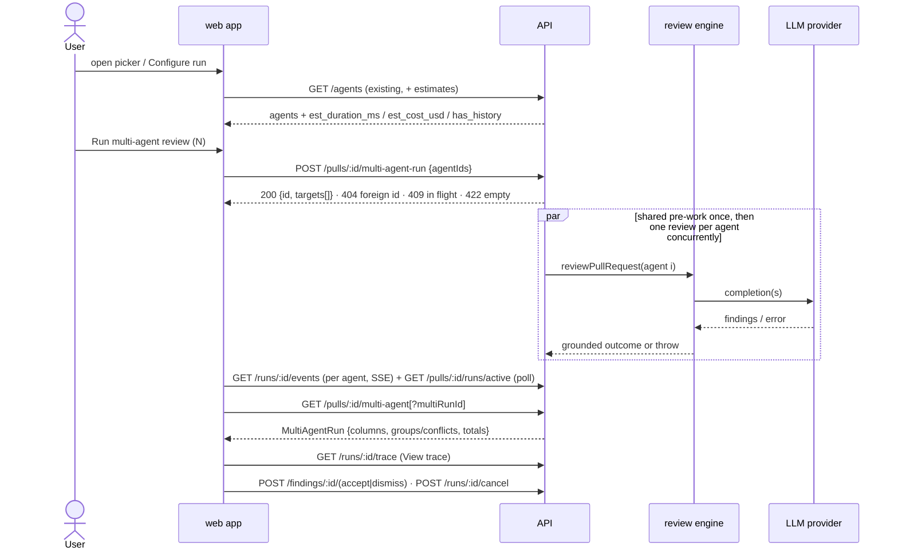

# Spec: Multi-Agent Review (agent picker, Configure run, Columns / Tabs results, Where agents disagree)

Spec ID: SPEC-07
Status: approved
Created: 2026-10-12
Approved: 2026-10-12 by user
Modules: client · server
Supersedes: none
Superseded by: none

## Problem and user
A reviewer looking at one pull request often faces several kinds of risk at once:
security, performance and domain-rule violations. Several specialised agents
cover more of that ground than one agent. That only pays off if the product
removes duplicates, shows where the agents disagree, and does not hide the cost.

Today:
- The PR page's Run Review control runs either one agent or "all enabled agents"
  (`client/src/app/repos/[repoId]/pulls/[number]/_components/RunReviewDropdown/RunReviewDropdown.tsx:54-82`).
  The trigger contract accepts only `agentId` or `all`
  (`server/src/vendor/shared/contracts/platform.ts:267-270`,
  `server/src/modules/reviews/service.ts:46-57`). No arbitrary set can be chosen.
- A batch of agent runs executes **sequentially**: `for … await this.runOneAgent`
  (`server/src/modules/reviews/run-executor.ts:121-148`). "Parallel" is not true
  today.
- The table `multi_agent_runs` exists only as a stub with `id, workspace_id,
  pr_id, ran_at` (`server/src/db/schema/runs.ts:43-52`). `agent_runs` has no link
  to it (`server/src/db/schema/runs.ts:8-33`).
- The contracts `MultiAgentRun`, `AgentColumn`, `Conflict` and `ConflictTake`
  exist (`server/src/vendor/shared/contracts/observability.ts:22-86`), but no route
  implements them (`server/src/modules/reviews/routes.ts:10-17`).
- No multi-agent page exists. The sidebar has no "Multi-Agent Review" item
  (`client/src/vendor/ui/nav.ts:21-45`); only active-key detection is present
  (`client/src/components/app-shell/helpers.ts:28`).
- Nothing groups findings across agents, and runs carry no pre-run time or cost
  estimate.

## Goals / Non-goals
**Goals**
| ID | Goal | Success measure |
|---|---|---|
| G-1 | Run a user-chosen set of agents on one PR in one action, from the PR page or from Configure run | One click starts exactly the checked agents. One multi-agent run groups them (AC-6, AC-13, AC-22) |
| G-2 | Agents of one batch run concurrently | A batch's agent reviews all start within 1 s after shared pre-work (AC-24). The batch wall-clock is recorded (AC-61) |
| G-3 | Duplicates collapse without losing authorship | Findings at the same file and overlapping lines form one match group. Every original's agent, severity and text stay reachable (AC-46, AC-48, AC-49) |
| G-4 | Disagreements are visible | Each group shows one take per agent of the run, including "did not flag". A filter shows conflicts only (AC-51 – AC-54) |
| G-5 | Cost and time are shown honestly, before and after the run | Pre-run estimate (AC-19). Wall-clock total and cost total with unpriced runs counted (AC-61 – AC-63). Shared pre-work cost reported separately (AC-64) |
| G-6 | Live per-agent status and trace | Each column changes status within 5 s of the API recording it (AC-35). View trace opens the existing drawer (AC-58) |
| G-7 | The "1 agent vs 3 agents" measurement is recorded with real numbers | VP-1 table filled in the implementation PR |

**Non-goals**
- Any change to `ci/`, `agent-runner/` or `reviewer-core/`. The grounding gate and untrusted-input wrapping stay as they are.
- A working **Learn** action. The design itself has it as a stub: `Dev_Digest_Design/findings.jsx:19-26` (`ActionRow`) wires `onClick` only for Accept, Dismiss and Turn into eval case, and Learn (line 23) has no handler. User rule: what the design has only as a stub is not implemented. Learn is shown visible but disabled with "Coming soon" (AC-43) and sends no request. The upstream full-functionality spec (D24) implemented Learn by writing into the `memory` table; that is deliberately out of scope here.
- A working **Reply to author** action, for the same reason: `findings.jsx:26` renders it with no handler. It is also an outbound GitHub side effect. It is shown visible but disabled with "Coming soon" (AC-43) and sends no request. No AC of this spec requires a working Learn or Reply.
- Predicting each agent's findings before the run. The Configure run card shows the agent's stored description instead (AC-11).
- Semantic or embedding-based similarity between findings (AC-46).
- A history browser over all multi-agent runs. Only the latest run, or the run named in the URL, is shown (AC-32, AC-69).
- Storing computed groups or conflicts: they are computed on read.
- Agent colour and icon fields in the schema. Visual identity is derived from the agent's identity (EC-12).
- Per-agent stats and the Agent Performance page (`AgentStats`, `observability.ts:96-119`).
- An MCP tool or an e2e flow for this feature.
- Any limit on how many agents run at once. Only the request size is validated (UT-9).

## User stories
- **US-1** — As a reviewer on a PR page, I want to check the agents to run from the Run Review control, so that I fan out exactly the specialists this PR needs.
- **US-2** — As a reviewer, I want a Configure run screen where I pick a PR and agents, so that I start a multi-agent review deliberately from one place.
- **US-3** — As a reviewer, I want to see a time and cost estimate per agent and for my selection before I run, so that I know the price before I commit.
- **US-4** — As a reviewer, I want the selected agents to run concurrently as one grouped run, where one failure does not cancel the others, so that the run takes about as long as the slowest agent.
- **US-5** — As a reviewer, I want a Columns view with live per-agent status, score, duration, cost and findings, so that I can see who has finished, who is still running and who failed.
- **US-6** — As a reviewer, I want a Tabs + detail view where I expand a finding and act on it, so that I can triage one agent's output in place.
- **US-7** — As a reviewer, I want similar findings grouped and disagreements shown per code location, with authors and original text still accessible, so that I do not read the same finding three times and I can see where my judgement is needed.
- **US-8** — As a reviewer, I want each agent's trace, so that I can explain its tokens, cost and grounding-gate decisions.
- **US-9** — As a reviewer, I want truthful totals and a recorded "1 vs 3 agents" measurement, so that the product does not hide or fudge cost.
- **US-10** — As a reviewer who left a run, I want to get back to it from the sidebar, the URL or the PR page, so that I never re-run agents just to see results again.

## Acceptance criteria (EARS)

Terms defined once:
- A **multi-agent run** is one grouping identity over the agent runs started together on one PR.
- A **participating agent** is an agent of that multi-agent run whose agent run has status `done`.
- A **match group** is a set of findings from the run's agent runs that share a file and whose `[start_line, end_line]` ranges overlap, inclusively, directly or through other findings in the group.
- A **conflict** is a match group in which at least one participating agent has no finding, or in which participating agents' findings carry different severities.
- **Shared pre-work** is the once-per-batch diff load and intent derivation (`run-executor.ts:99-119`).

**PR-page agent picker (US-1)**
| ID | Pattern | Requirement | Story | Priority | Verify by |
|---|---|---|---|---|---|
| AC-1 | Event-driven | WHEN the user opens the Run Review control on the PR page, the web app shall show a "Pick agents to run" list with one checkbox and one time estimate per enabled agent, in place of the run-all and single-agent menu items. | US-1 | Must | unit (RTL) — open the control with 3 enabled and 1 disabled agent → assert 3 checkbox rows with estimates and no "Run all" item |
| AC-2 | Event-driven | WHEN the picker or Configure run opens, the web app shall pre-check the agent set of the user's last started multi-agent run in this workspace, or every enabled agent when no previous selection is remembered. | US-1 | Should | unit — with and without a remembered selection → assert the checked set |
| AC-3 | State-driven | WHILE N ≥ 1 agents are checked, the web app shall show an enabled run action labelled "Run multi-agent review (N)". | US-1 | Must | unit — check 1, then 2 agents → assert the label and the enabled state |
| AC-4 | State-driven | WHILE no agent is checked, the web app shall show the run action disabled. | US-1 | Must | unit — clear all → assert disabled; check one → assert enabled |
| AC-5 | Event-driven | WHEN the user clicks Clear in the picker, the web app shall uncheck every agent. | US-1 | Should | unit — click Clear → assert 0 checked |
| AC-6 | Event-driven | WHEN the user activates the picker's run action, the web app shall start one multi-agent run over exactly the checked agents and open that run's results page. | US-1 | Must | unit — fetch mock asserts the `agentIds` body equals the checked set and the router receives the results URL |
| AC-7 | Event-driven | WHEN the user clicks "Configure agents…" in the picker, the web app shall open Configure run with the current PR preselected. | US-1 | Should | unit — click → assert the navigation target carries the PR |
| AC-8 | Optional feature | WHERE the PR is merged or closed, the web app shall show the existing merged-PR warning in the picker and keep the run action available. | US-1 | Could | unit — merged PR → warning row is present and the run action is enabled |

**Configure run (US-2)**
| ID | Pattern | Requirement | Story | Priority | Verify by |
|---|---|---|---|---|---|
| AC-9 | Ubiquitous | The web app shall show a "Multi-Agent Review" item in a GLOBAL sidebar section that resolves to the multi-agent section. | US-2 | Must | unit — the nav list contains the item with key `multi-agent`; its route resolves to that key in `activeKeyFor` |
| AC-10 | State-driven | WHILE no PR is selected on Configure run, the web app shall show the "Pick a pull request first" empty state in place of the agent list and keep the run action disabled. | US-2 | Must | unit — no PR → assert the empty state and the disabled run action |
| AC-11 | Event-driven | WHEN a PR is selected on Configure run, the web app shall list one selectable card per enabled agent, showing the agent's name, its stored description and its estimate. | US-2 | Must | unit — select a PR → assert the cards with name, description and estimate |
| AC-12 | Event-driven | WHEN the user clicks "Select all" on Configure run, the web app shall check every listed agent. | US-2 | Should | unit — click → assert all checked and the link reads "Clear all" |
| AC-13 | Event-driven | WHEN the user activates the run action on Configure run, the web app shall start one multi-agent run over the selected agents for the selected PR and open that run's results page. | US-2 | Must | unit — fetch mock body and navigation assertion |
| AC-14 | State-driven | WHILE the workspace has no enabled agent, the web app shall show the "Enable agents to run reviews" state with a link to the Agents page in place of the agent list and the run action. | US-2 | Should | unit — empty agent list → assert the state and the link |
| AC-15 | Event-driven | WHEN the user selects a PR on Configure run that already has a multi-agent run, the web app shall show a "View latest results" link above the agent list, without navigating away on its own. | US-10 | Should | unit — a PR with a run → link is visible and no navigation happens |

**Estimates (US-3)**
| ID | Pattern | Requirement | Story | Priority | Verify by |
|---|---|---|---|---|---|
| AC-16 | Ubiquitous | The API shall return with every agent in `GET /agents` an estimated duration equal to the mean `duration_ms` of that agent's `done` agent runs, and an estimated cost equal to the mean `cost_usd` of its `done` agent runs whose cost is not null. | US-3 | Must | integration (`*.it.test.ts`) — seed 3 done runs (8 s/$0.06, 6 s/$0.04, 7 s/null) → assert 7000 ms and $0.05 |
| AC-17 | Unwanted behaviour | IF an agent has no `done` agent run, THEN the API shall return its estimated duration and cost as null with `has_history: false`. | US-3 | Must | integration — agent with only failed runs → nulls and `has_history: false` |
| AC-18 | Unwanted behaviour | IF an agent has `done` runs but none with a known cost, THEN the API shall return a duration estimate and a null cost estimate for it. | US-3 | Should | integration — only unpriced done runs → duration present, cost null |
| AC-19 | Event-driven | WHEN the agent selection changes in the picker or Configure run, the web app shall show the summary "≈ <max of selected duration estimates> · $<sum of selected cost estimates> · parallel fan-out". | US-3 | Must | unit — select 8.2 s/$0.06 and 3.1 s/$0.04 → "≈ 8.2s · $0.10 · parallel fan-out" |
| AC-20 | Unwanted behaviour | IF a selected agent has a null estimate, THEN the web app shall show "no history" in its row and leave that value out of the summary. | US-3 | Must | unit — one agent without history → its row reads "no history" and the summary ignores it |

**Grouped, concurrent execution (US-4)**
| ID | Pattern | Requirement | Story | Priority | Verify by |
|---|---|---|---|---|---|
| AC-21 | Event-driven | WHEN the user opens Configure run, selects a PR or changes the agent selection, the web app shall send only `GET` requests to the API. | US-3 | Should | unit — the fetch mock records only `GET` calls during the configure flow (NFR-3 covers the 0 LLM calls server-side) |
| AC-22 | Event-driven | WHEN the API receives `POST /pulls/:id/multi-agent-run` with a list of agent ids, the API shall create one multi-agent run and one agent run per distinct listed agent, each linked to that multi-agent run. | US-4 | Must | integration — post 3 ids → 1 multi-agent run row and 3 linked agent runs |
| AC-23 | Event-driven | WHEN the API has created a multi-agent run, the API shall respond with its id and one `{run_id, agent_id, agent_name}` entry per agent run before any agent review completes. | US-4 | Must | integration — stub LLM blocked → response arrives while every run is still `running` |
| AC-24 | Event-driven | WHEN the API executes a batch of agent runs from any review trigger, the API shall start every agent's review within 1 s after shared pre-work completes. | US-4 | Must | integration — 3 agents with a stub LLM delaying 3 s each → batch completes in < 6 s, and the per-agent start timestamps are within 1 s of each other |
| AC-25 | Unwanted behaviour | IF one agent run of a batch fails or is cancelled, THEN the API shall complete every other agent run of that batch with its own outcome. | US-4 | Must | integration — stub provider throws for agent B → A and C reach `done` with persisted findings |
| AC-26 | State-driven | WHILE agent runs of a batch execute concurrently, the API shall deliver each agent-specific event only to the event stream of the agent run that produced it. | US-4 | Must | integration — subscribe to 2 runs → each stream holds the shared pre-work events plus only its own agent's events |
| AC-27 | Ubiquitous | The API shall load the PR diff and derive the PR intent once per batch, before any agent review starts. | US-4 | Should | integration — a 3-agent batch emits one "Loading PR diff" step per run buffer and makes 1 diff load |
| AC-28 | Unwanted behaviour | IF the agent id list contains an id that is unknown or belongs to another workspace, THEN the API shall reject the whole request with HTTP 404 and create no multi-agent run and no agent run. | US-4 | Must | integration — one valid id plus one foreign id → 404, 0 new rows |
| AC-29 | Unwanted behaviour | IF the agent id list is empty, THEN the API shall reject the request with HTTP 422. | US-4 | Must | integration — `[]` → 422 |
| AC-30 | State-driven | WHILE a multi-agent run of a PR has an agent run with status `running`, the API shall answer a new `POST /pulls/:id/multi-agent-run` for that PR with HTTP 409 carrying the in-flight multi-agent run id. | US-4 | Should | integration — two quick posts → 1 multi-agent run, the second answer is 409 with the first id |

**Results page, common (US-5, US-6)**
| ID | Pattern | Requirement | Story | Priority | Verify by |
|---|---|---|---|---|---|
| AC-31 | Event-driven | WHEN the results page opens, the web app shall show a header with the "Configure run" button, "<N> selected agents · parallel", the PR number and title, and "<N> agents · parallel fan-out · <total time> total · <total cost>". | US-5 | Must | unit — render the fixture → assert the header text, with no "worktrees" or "p-queue" text |
| AC-32 | Event-driven | WHEN the API receives `GET /pulls/:id/multi-agent`, the API shall return the `MultiAgentRun` named by the `multiRunId` query parameter, or the PR's latest multi-agent run when the parameter is absent. | US-5 | Must | integration — two runs on one PR → no param returns the newer one; the param returns the older one |
| AC-33 | Event-driven | WHEN the user switches between Columns and Tabs, the web app shall change the layout without sending a request to the API. | US-5 | Should | unit — toggle → fetch mock call count unchanged |

**Columns (US-5)**
| ID | Pattern | Requirement | Story | Priority | Verify by |
|---|---|---|---|---|---|
| AC-34 | State-driven | WHILE Columns mode is active, the web app shall render one column per agent run, showing the agent's name, status, score ring, duration, cost, findings list, findings count and a "View trace" link. | US-5 | Must | unit — 4-column fixture → assert each element per column |
| AC-35 | State-driven | WHILE an agent run is `running`, the web app shall show its column status as running, and switch it to the recorded terminal status within 5 s after the API records that status. | US-5 | Must | unit — fake timers: status flips in the mocked API → the column updates within one 4 s poll |
| AC-36 | Unwanted behaviour | IF an agent run failed, THEN the web app shall show its column as failed with the recorded error text, while the other columns keep rendering their results. | US-4 | Must | unit — fixture with 1 failed column → error text present, siblings intact |
| AC-37 | Unwanted behaviour | IF an agent run was cancelled, THEN the web app shall show its column as cancelled. | US-4 | Should | unit — cancelled fixture → "cancelled" label |
| AC-38 | Optional feature | WHERE a participating agent produced no findings, the web app shall show "No findings." in its column. | US-5 | Should | unit — empty findings fixture |

**Tabs + detail (US-6)**
| ID | Pattern | Requirement | Story | Priority | Verify by |
|---|---|---|---|---|---|
| AC-39 | State-driven | WHILE Tabs mode is active, the web app shall show one tab per agent run with the agent's name and score, and for the active tab a summary card with the score ring, the summary, the duration, the cost and a "View trace" link. | US-6 | Must | unit — click the second tab → assert its summary card |
| AC-40 | Event-driven | WHEN the user expands a finding in Tabs mode, the web app shall show its confidence percentage, category, rationale, suggested fix and the actions Accept, Dismiss, Learn, Turn into eval case and Reply to author. | US-6 | Must | unit — expand → assert the fields and the 5 actions |
| AC-41 | Event-driven | WHEN the user clicks Accept or Dismiss on a finding in Tabs mode, the API shall persist the action through the existing `POST /findings/:id/(accept\|dismiss)` route. | US-6 | Must | unit (client) — fetch mock asserts the route; existing server tests cover persistence |
| AC-42 | Event-driven | WHEN the user clicks Turn into eval case on a finding in Tabs mode, the web app shall open the existing eval-case draft for that finding (SPEC-06). | US-6 | Should | unit — click → assert the draft modal opens with the finding id |
| AC-43 | Ubiquitous | The web app shall render Learn and Reply to author in Tabs mode as disabled buttons with a "Coming soon" tooltip that send no request. | US-6 | Should | unit — click both → fetch mock not called; the `disabled` attribute is present |
| AC-44 | Ubiquitous | The web app shall show next to every agent score a legend stating that a higher score is better. | US-5 | Could | unit — the legend text is present in both modes |

**Match groups and Where agents disagree (US-7)**
| ID | Pattern | Requirement | Story | Priority | Verify by |
|---|---|---|---|---|---|
| AC-45 | Ubiquitous | The API shall return with a `MultiAgentRun` every match group of its agent runs' findings, each with the file, the lowest start line in the group, the title of the group's highest-severity finding and one take per agent of the multi-agent run. | US-7 | Must | unit — pure function over a fixture |
| AC-46 | Ubiquitous | The API shall place two findings in one match group if and only if they cite the same file and their inclusive `[start_line, end_line]` ranges overlap, directly or through another finding of the group. | US-7 | Must | unit — lines 10–20 and 18–25 in one file → 1 group; the same ranges in two files → 2 groups; A~B~C chain → 1 group |
| AC-47 | Ubiquitous | The API shall keep every original finding of a match group, with its agent, severity, title, rationale and suggestion, reachable from the `MultiAgentRun` response. | US-7 | Must | unit — a group of 3 findings → all 3 ids are present in their agents' columns |
| AC-48 | Optional feature | WHERE a finding belongs to a match group with findings from N ≥ 1 other agents, the web app shall show a "+N agents" chip on that finding in both modes. | US-7 | Should | unit — Retry-After fixture flagged by 2 agents → chip "+1 agents" on each |
| AC-49 | Event-driven | WHEN the user opens a "+N agents" chip, the web app shall list every original finding of the group with its agent name, severity, title and rationale. | US-7 | Should | unit — click the chip → assert the list |
| AC-50 | Ubiquitous | The web app shall show the "Where agents disagree" section below the results in both Columns and Tabs modes. | US-7 | Must | unit — the section is present in both modes |
| AC-51 | Event-driven | WHEN the web app renders a match group, the web app shall show its `file:line`, its title and, for every participating agent that has a finding in the group, that agent's highest severity and that finding's title. | US-7 | Must | unit — fixture → severity and title per flagging agent |
| AC-52 | Event-driven | WHEN the web app renders a match group, the web app shall show "did not flag" with the agent's stored description as the reason for every participating agent that has no finding in the group. | US-7 | Must | unit — fixture → "did not flag" plus description for non-flagging agents |
| AC-53 | Event-driven | WHEN the web app renders a match group, the web app shall show the agent run's status (`failed`, `cancelled` or `running`) in place of a verdict for every agent of the run that is not participating. | US-7 | Must | unit — one failed agent → its take reads "failed", never "did not flag" |
| AC-54 | Optional feature | WHERE "Show only conflicts" is on, the web app shall show only the match groups that are conflicts. | US-7 | Must | unit — fixture with 1 unanimous and 2 conflicting groups → toggle on: 2 groups |
| AC-74 | State-driven | WHILE "Show only conflicts" is off, which is its initial state, the web app shall show every match group. | US-7 | Must | unit — same fixture on first render → 3 groups; toggle on then off → 3 groups |
| AC-55 | Unwanted behaviour | IF fewer than two agents of the multi-agent run are participating, THEN the web app shall show "Comparing agents needs at least two successful runs" in place of the conflict filter result. | US-7 | Should | unit — 1-agent run fixture |
| AC-56 | Optional feature | WHERE "Show only conflicts" is on and no match group is a conflict, the web app shall show "No conflicts — the agents agree on every flagged location." | US-7 | Should | unit — unanimous fixture with the toggle on |
| AC-57 | Event-driven | WHEN the user clicks an agent's take in a disagreement row, the web app shall switch to Tabs mode with that agent's tab active and its finding of the group expanded. | US-7 | Could | unit — click → active tab and expanded card |

**Trace (US-8)**
| ID | Pattern | Requirement | Story | Priority | Verify by |
|---|---|---|---|---|---|
| AC-58 | Event-driven | WHEN the user clicks "View trace" in a column or a Tabs summary card, the web app shall open the existing run trace drawer for that agent run. | US-8 | Must | unit — click → the drawer mounts with that `run_id` |
| AC-59 | State-driven | WHILE the agent run shown in the drawer is `running`, the web app shall show that run's live event stream in the drawer. | US-8 | Must | unit — running fixture → Live log tab active with that run's events |
| AC-60 | Event-driven | WHEN an agent run of a multi-agent run completes, the API shall serve its persisted trace with tokens in and out, cost, the grounding summary, and one log line per finding dropped by the grounding gate with its reason. | US-8 | Must | integration — a stub LLM returning 1 ungrounded finding → the trace log contains `grounding dropped "<title>": <reason>` |

**Totals and honest cost (US-9)**
| ID | Pattern | Requirement | Story | Priority | Verify by |
|---|---|---|---|---|---|
| AC-61 | Ubiquitous | The API shall report a multi-agent run's total duration as the wall-clock time from the multi-agent run's creation to the last of its agent runs reaching a terminal status. | US-9 | Must | integration — stub delays (pre-work 1 s, agents 2 s and 3 s) → total ≥ 4 s and < 5 s, not the max of agent durations |
| AC-62 | Ubiquitous | The API shall report a multi-agent run's total cost as the sum of its agent runs' known `cost_usd`, plus the count of its agent runs whose cost is null. | US-9 | Must | integration — costs 0.06, null, 0.04 → total 0.10 and 1 unpriced |
| AC-63 | Optional feature | WHERE a multi-agent run has unpriced agent runs, the web app shall show the total cost as "$<sum> + <n> unpriced". | US-9 | Must | unit — fixture with 1 unpriced run |
| AC-64 | Event-driven | WHEN the shared pre-work of a multi-agent run makes an intent classifier call, the API shall report that call's tokens and cost as a separate shared pre-work item of that multi-agent run. | US-9 | Should | integration — no stored intent → item with tokens > 0; its cost equals the classifier's reported cost |
| AC-65 | Event-driven | WHEN the shared pre-work of a multi-agent run reuses a stored intent, the API shall report the shared pre-work item as 0 LLM calls. | US-9 | Should | integration — fresh stored intent → item reports 0 calls |
| AC-66 | Optional feature | WHERE a multi-agent run has a shared pre-work item with an LLM call, the web app shall show "incl. $<cost> shared pre-work" next to the total cost. | US-9 | Should | unit — fixture with a classifier item |

**Navigation, resume and cancel (US-10)**
| ID | Pattern | Requirement | Story | Priority | Verify by |
|---|---|---|---|---|---|
| AC-67 | Event-driven | WHEN the user activates the Multi-Agent Review sidebar item and the workspace has at least one multi-agent run, the web app shall open the results page of the workspace's latest multi-agent run. | US-10 | Should | unit — latest exists → navigation target is its results URL; browser Back returns to the previous page |
| AC-68 | Event-driven | WHEN the user activates the Multi-Agent Review sidebar item and the workspace has no multi-agent run, the web app shall open Configure run. | US-10 | Should | unit — latest is null → Configure run |
| AC-69 | Ubiquitous | The web app shall carry the multi-agent run id in the results page URL, so that a reload or a shared link opens the same run. | US-10 | Should | unit — render with `?multiRunId=X` → the request names X |
| AC-70 | Event-driven | WHEN the user clicks "Configure run" on the results page, the web app shall open Configure run with the same PR and agent set preselected. | US-10 | Should | unit — click → preselected PR and agents |
| AC-71 | Optional feature | WHERE a PR has a multi-agent run, the web app shall show on the PR page a link to that PR's latest multi-agent results that starts no run. | US-10 | Could | unit — link present; clicking it sends no POST |
| AC-72 | State-driven | WHILE at least one agent run of the shown multi-agent run is `running`, the web app shall show a "Cancel all" button in the results header. | US-5 | Should | unit — running fixture → button present; all-terminal fixture → absent |
| AC-73 | Event-driven | WHEN the user clicks "Cancel all", the web app shall send the existing `POST /runs/:id/cancel` for every agent run of that multi-agent run that is `running`. | US-5 | Should | unit — 2 running + 1 done → 2 cancel calls |

## Edge cases
| ID | Case | Expected behaviour (EARS, or "→ AC-n") | Verify by |
|---|---|---|---|
| EC-1 | Shared diff load fails (`run-executor.ts:99-108` fails every queued run) | IF the shared pre-work fails, THEN the web app shall show the one shared failure reason above the columns, in place of N identical per-column errors. | unit — every column failed with the same error → one banner |
| EC-2 | Every agent run fails | IF every agent run of a multi-agent run failed, THEN the web app shall show "No results" with each agent's recorded failure reason, and no match groups. | unit — fixture |
| EC-3 | Server restarts mid-run (in-memory bus lost; stale runs reaped on boot, `server/src/modules/reviews/service.ts:93-95`) | IF an agent run is reaped as failed after a restart, THEN the web app shall show that column as failed at the next status poll. | integration — reap then read → status `failed` |
| EC-4 | Agent deleted after the run (`agent_runs.agent_id` set null on delete, `runs.ts:13`) | IF an agent run's agent no longer exists, THEN the API shall return its column with the agent name "Unknown agent" and its stored results. | integration — delete agent, read run |
| EC-5 | User navigates away mid-run and comes back | WHEN the results page opens for a multi-agent run that is in flight, the web app shall show per-agent status from the API rather than a "no run" state. | unit — running fixture |
| EC-6 | Unknown `multiRunId`, or a run belonging to another PR or workspace | IF the requested multi-agent run is not found for that PR in the caller's workspace, THEN the API shall answer HTTP 404. | integration — foreign id → 404 |
| EC-7 | Results page for a PR with no multi-agent run | IF the PR has no multi-agent run, THEN the web app shall show "No multi-agent run yet" with a link to Configure run for that PR. | unit — fixture |
| EC-8 | Event stream drops | IF the event stream of a running agent run closes before the run ends, THEN the web app shall take that column's status from the polled run status within 5 s. | unit — close the mock EventSource → status from poll |
| EC-9 | Provider 429 or 402 for one agent under concurrency (R-2) | → AC-25, AC-36 (that agent fails with the provider error; the others continue) | integration — stub 429 for one agent |
| EC-10 | Finding range spans most of a file (full-file kinds) | Grouped by AC-46 as is. Flooding is accepted for now → Q-1 | — |
| EC-11 | Finding accepted or dismissed after the run | WHEN a finding of a multi-agent run is accepted or dismissed, the API shall return the same match groups as before the action. | unit — groups ignore triage fields |
| EC-12 | More than 5 agents, or long agent names | WHILE a multi-agent run has more than 5 agent runs, the web app shall render the columns in a horizontally scrollable row, each column at least 220 px wide (design `screen_multiagent.jsx:52-56`). | unit — 6-agent fixture → scroll container |
| EC-13 | Remembered selection names an agent that is now disabled or deleted | IF the remembered selection contains an agent that is not in the enabled agent list, THEN the web app shall leave that agent out of the preselection. | unit — stale id dropped |
| EC-14 | Only one agent selected | → AC-55 (results render; the comparison message replaces the conflict list) | unit |
| EC-15 | A second multi-agent run on the same PR after the first finished | WHEN a new multi-agent run is created for a PR, the API shall keep the earlier multi-agent run and its agent runs readable by `multiRunId`. | integration |

## Module interactions

| From → To | Contract (endpoint / function / tool / table) | Data | Source of truth | On failure / timeout / stale data |
|---|---|---|---|---|
| web app → API | `GET /agents` (existing, `server/src/modules/agents/routes.ts:74-77`, extended additively) | agents + per-agent estimate fields | `agent_runs` rows of `done` runs | Request fails → picker shows the agents without estimates and with "no history" values; the run action stays usable |
| web app → API | `POST /pulls/:id/multi-agent-run` (new; name reserved at `observability.ts:74`) | `{agentIds: string[]}` → `{id, pr_id, targets[]}` | API | 404 / 409 / 422 / 429 → the run action stays on the page and shows the error message; 409 offers a link to the in-flight run |
| API → review engine | `reviewPullRequest` (existing, called at `run-executor.ts:218-250`) | diff, agent prompt, context | engine output + grounding | Throw → that agent run is `failed` with the error text (`run-executor.ts:356-381`); siblings continue (AC-25) |
| review engine → LLM | provider adapters (existing) | prompt / completion | provider | 429 / 402 / timeout → that agent fails in isolation (EC-9) |
| API → Postgres | `multi_agent_runs`, `agent_runs`, `reviews`, `findings`, `run_traces` (existing tables + new link) | grouping, per-run results | Postgres | Write failure of one agent's rows → that agent run is `failed`; the multi-agent run stays readable |
| web app → API | `GET /runs/:id/events` SSE (existing, `routes.ts:48-92`) + `GET /pulls/:id/runs/active` poll every 4 s (existing, `client/src/lib/hooks/reviews.ts:33`) | per-run events, statuses | in-memory run bus (live) / `agent_runs.status` (durable) | Stream drop or server restart → status from the poll (EC-8, EC-3) |
| web app → API | `GET /pulls/:id/multi-agent` (new; reserved at `observability.ts:74`) | `MultiAgentRun` | Postgres; groups computed on read | 404 → not-found state (EC-6); stale while running → refetched when any run settles |
| web app → API | `GET /runs/:id/trace` (existing, `routes.ts:121-126`) | `RunTrace` | `run_traces` | 404 while running → drawer shows the live log (`client/messages/en/runs.json:85`) |
| web app → API | `POST /findings/:id/(accept\|dismiss)`, `POST /runs/:id/cancel` (existing, `routes.ts:114-118`, `:143-149`) | action | Postgres | Error → toast; card state unchanged |
| web app → API | latest multi-agent run for the workspace and for a PR (new reads) | `{id, pr_id, pr_number} \| null` | Postgres | Error → sidebar opens Configure run; PR-page link hidden |

## Data and state
- **Multi-agent run** (existing `multi_agent_runs` stub): owned by the API, scoped to the workspace and the PR. It gains:
  - the set of agent runs it groups, as a link from each agent run to its multi-agent run;
  - its shared pre-work item: whether an intent classifier call was made during the run, with its tokens and cost (AC-64, AC-65);
  - the data needed for wall-clock duration: creation time plus the agent runs' terminal times (AC-61).

  The schema change ships as a new append-only migration with the next free number after `0019_eval_reshape_drop.sql`. The upstream reference's `0012`/`0013` numbers are taken here and are not reused.
- **Existing agent runs** have no multi-agent run. They belong to none and are never shown in multi-agent results. No backfill.
- **Groups and conflicts** are computed on read from persisted findings and never stored.
- **Remembered agent selection** (AC-2) is kept on the client per workspace. It is not persisted on the server.
- **Deletion:** deleting an agent run through the existing `DELETE /runs/:id` removes it from its multi-agent run's columns. Deleting the PR cascades to the multi-agent run (`runs.ts:48-50`). Deleting an agent leaves its runs with "Unknown agent" (EC-4).

## Compatibility and rollout
- **`POST /pulls/:id/review`** keeps its contract and response (`routes.ts:27-44`). Its batch now executes concurrently (AC-24), so the existing single-agent and run-all paths are also concurrent. They must produce the same persisted rows and per-run events as before (NFR-6).
- **PR-page Run Review control:** the picker replaces the run-all and single-agent items (AC-1). It is no longer possible to run a **disabled** agent from the PR page. That stays possible through the API's `agentId` form, which remains unchanged.
- **Vendored contracts:** both copies are changed identically (`server/src/vendor/shared`, `client/src/vendor/shared`). The changes are additive:
  - `AgentColumn.status` gains `cancelled` and the column gains an error text;
  - `MultiAgentRun` gains the unpriced count and the shared pre-work item;
  - the trigger body is new;
  - the agent list gains the estimate fields.

  `ConflictTake.verdict` keeps `'ignored'` as the wire value for "did not flag". A non-participating status is carried as its own value. The `conflicts` array of `MultiAgentRun` carries **every** match group, as in the L07 reference; "conflict" filtering happens in the web app (AC-54). Its doc comment (`observability.ts:61-64`) is updated to say so.
- **PR-page finding cards** keep today's action set: Accept, Dismiss, Turn into eval case (`FindingCard.tsx:92-114`). Learn and Reply placeholders appear only in Multi-Agent Review Tabs mode.
- **Existing copy keys** `page.meta` ("fan-out via p-queue") and `page.subtitle` / `noRun.bodyReady` ("every enabled agent") (`client/messages/en/runs.json:124`, `:133`, `:141`) are reworded to match AC-31 and AC-19.
- No feature flag. Users who never open the picker or the page see only the concurrent execution change.
- `ci/`, `agent-runner/`, `reviewer-core/` and `mcp/` are unchanged.

## Design review
**Sources analysed**
- Exported frames 1.png – 5.png (PR picker, Configure run empty and filled, Columns plus disagreements, Tabs plus detail), session image directory supplied by the user.
- Design source code: `C:\Users\mgume\PycharmProjects\dev-digest\Dev_Digest_Design\screen_multiagent.jsx` (whole file read: `RunConfig` 107-148, `ColumnsView` 52-65, `TabsView` 67-91, `ConflictsSection` 21-40, `MetaRow` 42-50) and `data.jsx:446-477` (`PERSONAS`, `PERSONA_CONFLICTS` with mock "did not flag" notes).
- Upstream lab reference `lesson-7-lab/multiagents-finish` (exported by the main session): `specs_2026-07-08-multi-agent-review.md` (D-1 – D-4, AC-1 – AC-24, OQ-4 – OQ-7), `server_src_modules_reviews_multi-agent-conflicts.ts` (same file plus overlapping ranges, union-find, highest-severity title, min start line), `server_src_modules_reviews_multi-agent-service.ts` (trigger, latest, latestForPr, read), `server_src_db_migrations_0012_productive_cannonball.sql` (`agent_runs.multi_run_id`), `server.diff:470-530` (`Promise.allSettled` fan-out), `client.diff:3510-3636` (Learn and Turn-into-eval placeholders), `docs_retros_2026-07-08-multi-agent-review-run.md`.
- Upstream `full-functionality` reference: `specs_13-multi-agent-review.md`. Borrowed: D8 participating agents only, AC-12 in-flight guard, AC-14 reject foreign ids, AC-24 wall-clock and unknown-cost total, AC-26 score legend, AC-42 fewer-than-two message, AC-50 one shared pre-work reason, AC-66/68 resume links without auto-redirect, D21 derived identity.
- Codebase, cited inline (`path:line`).
- Researcher reports:
  - R-1 (CODEBASE): concurrency is safe in-process. Intent single-flight per PR; tokens and cost of the classifier sit in `pr_intent`, not in agent runs. The trace has no structured grounding-dropped list, but the log carries one line per drop (`reviewer-core/src/review/run.ts:239-240`).
  - R-2 (WEB): simultaneous calls each pay cache-write price; cache TTL 5–30 min contaminates back-to-back measurements; 3–8 concurrency is fine on paid tiers; OpenRouter `:free` is 20 RPM; OpenRouter prepaid may answer 402.

**Decisions taken from the references (round 2: the user delegated Q2–Q9)**
| Q | Decision | Source |
|---|---|---|
| Q1 | More sources exist → used below | user answer |
| Q2 parallelism | Every batch runs its agents concurrently, with failure isolation and no concurrency cap; single-agent and run-all are observably unchanged apart from timing | L07 D-2 (`server.diff:498-503`); FF D16 / AC-19 → AC-24 – AC-26, NFR-6 |
| Q3 "did not flag" reason | Deterministic, no LLM: a flagging take shows the agent's finding title; a non-flagging take shows "did not flag" plus the agent's stored description | L07 `multi-agent-conflicts.ts:111-119` (deterministic note) + design notes (`data.jsx:466-476`) → AC-51, AC-52 |
| Q4 conflict definition | The API returns every match group; the "Show only conflicts" toggle (default off, design `screen_multiagent.jsx:23`) filters to conflicts; only `done` agents count as participating; others show their status | L07 conflicts file header + AC-23; FF D8 / AC-38 → AC-45, AC-53, AC-54 |
| Q5 grouping heuristic | Same file plus inclusive overlapping line ranges, transitive; title from the highest severity; anchor line is the lowest start | L07 D-1 / AC-21 and `multi-agent-conflicts.ts:39-150`; FF D7 → AC-45, AC-46 |
| Q6 estimates and totals | Estimate = mean of the agent's `done` runs (cost from priced runs only); no history → null and "no history"; summary = max time and sum cost. Results: wall-clock total, cost sum plus unpriced count, shared pre-work item | L07 AC-7 – AC-9; FF AC-24; UX-3; R-1(b) → AC-16 – AC-20, AC-61 – AC-66 |
| Q7 picker vs dropdown | The picker replaces the dropdown items; enabled agents only; every launch, even of 1 agent, creates a multi-agent run | L07 AC-1, AC-10; FF D23(a) → AC-1, AC-6, AC-22 |
| Q8 Learn / Reply | Accept and Dismiss work; Turn into eval case works (it exists here, SPEC-06); Learn and Reply are disabled placeholders | L07 D-4 / AC-19 (`client.diff:3622-3630`), adapted to this repo's working eval action → AC-40 – AC-43 |
| Q9 grounding in the trace | No new trace field: the existing per-drop log lines plus `stats.grounding` explain the gate | L07 AC-14a ("adds no new trace shape"); R-1(c) → AC-60 |
| Endpoints | New `POST /pulls/:id/multi-agent-run` and `GET /pulls/:id/multi-agent[?multiRunId]` instead of extending `POST /pulls/:id/review`. User requirement 2 assumed parallel execution already existed; the observable behaviour is the same | L07 D-3; `observability.ts:74` → AC-22, AC-32 |
| Defaults overridden by accepted UX | Selection is remembered (UX-1, against L07 OQ-4); "Configure agents…" opens Configure run (UX-2, against L07 OQ-7) | user acceptance |

**Gaps found**
| ID | Lens | Gap | Resolution (→ AC-n / EC-n / NFR-n / Q-n) |
|---|---|---|---|
| F-1 | Conflict | Batch execution is sequential (`run-executor.ts:121-148`) | AC-24, AC-25, AC-26, NFR-6 |
| F-2 | Module interaction | The trigger cannot take a set of agents (`platform.ts:267-270`) | AC-22, AC-23, AC-28, AC-29 |
| F-3 | Module interaction | No link from agent runs to multi-agent runs (`runs.ts:8-52`) | AC-22, Data and state |
| F-4 | Gap | No cross-agent grouping heuristic in the code | AC-45, AC-46, AC-47 (heuristic from L07) |
| F-5 | Gap | No data for the "did not flag" reason | AC-52 |
| F-6 | Conflict | Design 4.png lists Architecture, which is not in the run, and shows Security "did not flag" at `ratelimit.ts:52` although Security flagged line 52 | AC-51, AC-52, AC-53: takes only for agents of the run; the overlap rule groups Security's line-52 finding |
| F-7 | Gap | The conflict definition floods the block; the toggle's off state is undefined | AC-54, AC-55, AC-56 |
| F-8 | Corner case | Pre-work failure fails all agents; status set lacks `cancelled` | EC-1, AC-37, Compatibility |
| F-9 | NFR | Intent classifier cost is hidden from agent totals | AC-64, AC-65, AC-66 |
| F-10 | NFR | `cost_usd` is null for non-OpenRouter runs (`server/INSIGHTS.md:47`) | AC-18, AC-62, AC-63 |
| F-11 | Gap | Estimate rule and no-history state undefined; the card teaser has no source before a run | AC-16 – AC-20, AC-11 (description) |
| F-12 | NFR | Agent duration excludes pre-work; "1 vs 3" needs wall-clock | AC-61, VP-1 |
| F-13 | Gap | Learn and Reply have no routes (`routes.ts:18`) | AC-43, Non-goals |
| F-14 | Compatibility | The dropdown can run single and disabled agents today | AC-1, Compatibility |
| F-15 | Module interaction | Live status per column; the trace exists only after completion | AC-35, AC-59, EC-8 |
| F-16 | Gap | Missing states: no agents, 0 selected, repeat run, reload, nav target | AC-4, AC-10, AC-14, AC-30, AC-67 – AC-69, EC-5, EC-7 |
| F-17 | Conflict | "fan-out via worktrees" / "p-queue" copy is untrue | AC-31, NFR-11 |
| F-18 | Gap | No agent colour or icon in the schema; seeded agents differ from the design | Non-goals (derived identity), VP-1 (seeded agents used) |
| F-19 | NFR | Grounding decisions in the trace | AC-60 |
| F-20 | Security | Markdown of LLM text, agent names, Reply side effect | UT-3, UT-4, UT-5, AC-43 |
| F-21 | NFR | Rate limit and provider throttling under concurrency | NFR-7, EC-9 |

**UX improvements**
| # | Proposal | Decision |
|---|---|---|
| UX-1 | Remember the last agent selection | accepted → AC-2, EC-13, UT-10 |
| UX-2 | "Configure agents…" opens Configure run with the PR preselected | accepted → AC-7 |
| UX-3 | Truthful subtitle and full cost ("+ N unpriced") | accepted → AC-31, AC-63, AC-66 |
| UX-4 | "+N agents" chip with the originals | accepted → AC-48, AC-49 |
| UX-5 | Click a disagreement take → that agent's tab | accepted → AC-57 |
| UX-6 | "Cancel all" while running | accepted → AC-72, AC-73 |
| UX-7 | Results URL bound to one multi-agent run | accepted → AC-69 |

## Non-functional requirements
| ID | Category | Requirement | Verify by |
|---|---|---|---|
| NFR-1 | Performance | WHEN the web app requests `GET /agents` on the seeded dataset plus 1 000 extra agent runs, the API shall respond within 500 ms at p95 over 20 requests. | integration — timed loop on the seeded DB |
| NFR-2 | Performance | WHEN the web app requests `GET /pulls/:id/multi-agent` for a run of 8 agents with 50 findings each, the API shall respond within 1 s at p95 over 20 requests. | integration — timed loop on a fixture |
| NFR-3 | Cost (LLM calls) | WHEN the API serves `GET /agents` or `GET /pulls/:id/multi-agent`, the API shall make 0 LLM calls. | integration — stub LLM call counter = 0 after the reads |
| NFR-4 | Cost (LLM calls) | WHEN a multi-agent run of N agents executes, the API shall make exactly N review executions and at most 1 intent classifier call. | integration — stub counters for N = 3 |
| NFR-5 | Determinism | The API shall return identical match groups, in identical order (file, then line), for identical stored findings, without any LLM or embedding call. | unit — property test over shuffled input order |
| NFR-6 | Reliability | WHEN a review is triggered through `POST /pulls/:id/review` with `agentId` or `all`, the API shall persist the same rows and emit the same per-run events as before this feature, apart from start timing. | integration — the existing review `*.it.test.ts` suite passes unchanged |
| NFR-7 | Security (abuse) | IF a client sends more than 10 `POST /pulls/:id/multi-agent-run` requests within 1 minute, THEN the API shall answer the excess with HTTP 429. | integration — 11 posts → the 11th gets 429 |
| NFR-8 | A11y | The web app shall make the agent checkboxes, Select all / Clear, the run action, the Columns/Tabs switch, the tabs, the conflicts toggle and every View trace link operable from the keyboard. | manual — keyboard walk-through of the full flow; axe check with 0 serious violations |
| NFR-9 | A11y | The web app shall show a text label for every agent run status, finding severity and take verdict, in addition to its colour. | unit — the status, severity and verdict text is present in the fixtures |
| NFR-10 | A11y | WHEN an agent run's status changes on the results page, the web app shall announce the new status in a polite live region. | unit — status flip → live region text updated |
| NFR-11 | I18n | The web app shall take every new user-facing string of this feature from `next-intl` messages. | inspection + unit — grep the new components for literal strings; grep the message files for "worktrees" / "p-queue" = 0 hits |

**Verification procedure (non-EARS process obligation from the user's acceptance scenario)**
- **VP-1 — "1 vs 3" measurement.** Before `implemented`, the verifier records a table in the implementation PR description for seeded PR #482: one agent (Security Reviewer) vs three agents (Security, Performance, General Reviewer).
  - Cold runs and warm runs are recorded separately. The provider prompt cache lasts 5–30 min (R-2), so back-to-back runs contaminate each other.
  - Each run records the wall-clock total (AC-61), per-agent duration, tokens in and out, cost or "unpriced" (AC-62), the shared pre-work item (AC-64), and provider-reported cached-token fields where available.
  - The 3-vs-1 ratio is reported as measured, with no adjustment toward 3×. Shared diff preparation, the single intent call, caching and differing response lengths are named as possible causes of a ratio other than 3×.
  - Verify by: manual. The table is present and its numbers match the stored agent runs.

## Inputs and provenance
| Input | Source | Trust |
|---|---|---|
| Agent id list in the trigger body | user form (client) | untrusted |
| `multiRunId` query parameter | URL | untrusted |
| Remembered agent selection | browser storage | untrusted |
| Agent names and descriptions | workspace configuration (DB) | untrusted for rendering |
| PR diff, title, body, file paths | GitHub / clone | untrusted |
| Finding title, rationale, suggestion, file, lines; review verdict and summary | LLM output (grounded) | untrusted |
| Agent run error text | provider and adapter errors (DB) | untrusted for rendering |
| Estimates, totals, groups | computed by the API from DB rows | trusted (derived) |

## Untrusted inputs
| ID | Input | Threat | Requirement | Verify by |
|---|---|---|---|---|
| UT-1 | Agent id list | broken access control (IDOR) | IF the agent id list names an agent outside the caller's workspace, THEN the API shall start no agent run for any listed id (→ AC-28). | integration — mixed ids → 0 runs |
| UT-2 | `multiRunId` | broken access control (IDOR) | IF `multiRunId` names a multi-agent run of another workspace or another PR, THEN the API shall answer HTTP 404 without any of its data. | integration — foreign id → 404, empty body data |
| UT-3 | Finding title, rationale, suggestion | HTML / Markdown injection | IF model-authored finding text contains raw HTML or a non-http(s) link target, THEN the web app shall render the HTML as visible text and render the link without an active `href`. | unit — `<script>` title and `javascript:` link fixture |
| UT-4 | Review verdict and summary, group titles, take notes | HTML injection | IF a verdict, summary, group title or take note contains markup, THEN the web app shall render it as plain text. | unit — `` fixture |
| UT-5 | Agent name and description | HTML injection | IF an agent name or description contains markup, THEN the web app shall render it as plain text in cards, columns, tabs and takes. | unit — hostile agent name fixture |
| UT-6 | PR diff, title, body | prompt injection steering a verdict | IF the PR diff or body contains instructions aimed at the model, THEN the API shall send each agent the same guarded prompt content as a single-agent review of that PR, with no additional repository content. | integration — capture prompts of a multi-agent run and a single run → identical per agent |
| UT-7 | Finding file path | path escape | IF a finding file path contains `../` or an absolute path, THEN the API shall use it only as a comparison string for grouping and shall open no file with it. | unit — `../../etc/passwd` fixture groups by string, no fs call |
| UT-8 | Agent run error text | secret leakage | IF a recorded error text contains a secret-shaped token (API key or GitHub token pattern), THEN the API shall return it masked in the column error. | unit — fixture built at runtime (`server/INSIGHTS.md:70`) → masked |
| UT-9 | Agent id list | oversized payload | IF the agent id list has more than 50 entries, THEN the API shall reject the request with HTTP 422. | integration — 51 ids → 422 |
| UT-10 | Remembered selection | tampered storage | IF the remembered selection is malformed or names unknown ids, THEN the web app shall ignore those entries and use the enabled-agent default. | unit — garbage value → default set |

## Assumptions and dependencies
- The diff loader, intent derivation and grounding gate stay as they are. Concurrency safety was confirmed by R-1: per-run loggers, a run bus keyed per run, method-local cost accumulators.
- The intent service is single-flight per PR. Under concurrency only the first run's live log shows the intent step lines (R-1). This is accepted.
- The in-memory run bus is not freed (R-1). Memory growth is a known, pre-existing issue, outside this spec.
- Real cost exists only for priced OpenRouter runs (`server/specs/cost-attribution.md:13`, `:72`). Estimates are never written into `agent_runs.cost_usd`.
- SPEC-06's eval-case draft action is reused as is (`FindingCard.tsx:113`).
- The existing trace drawer and live log stream are reused as is (`client/src/app/repos/[repoId]/pulls/[number]/page.tsx:195-203`, `RunStatus.tsx:38-43`).
- Verification uses the seeded demo PR #482 and the seeded General, Security and Performance Reviewers (`server/src/db/seed.ts:850-880`).

## Traceability
| Source (US / F / UX / answered question) | Requirements |
|---|---|
| US-1 | AC-1 – AC-8, EC-13 |
| US-2 | AC-9 – AC-14 |
| US-3 | AC-16 – AC-21 |
| US-4 | AC-22 – AC-30, AC-36, AC-37, EC-1, EC-9, NFR-4, NFR-6, NFR-7 |
| US-5 | AC-31 – AC-35, AC-38, AC-44, AC-72, AC-73, EC-3, EC-8, EC-12, NFR-2, NFR-8 – NFR-11 |
| US-6 | AC-39 – AC-43 |
| US-7 | AC-45 – AC-57, AC-74, EC-10, EC-11, EC-14, NFR-5 |
| US-8 | AC-58 – AC-60 |
| US-9 | AC-61 – AC-66, NFR-3, VP-1 |
| US-10 | AC-15, AC-67 – AC-71, EC-5, EC-6, EC-7, EC-15 |
| F-1 – F-21 | see Gaps found |
| UX-1 – UX-7 | see UX improvements |
| Q1 | Design review → Sources analysed |
| Q2 | AC-24 – AC-26, NFR-6 |
| Q3 | AC-51, AC-52 |
| Q4 | AC-45, AC-53 – AC-56, AC-74 |
| Q5 | AC-46, AC-47, NFR-5 |
| Q6 | AC-16 – AC-20, AC-61 – AC-66 |
| Q7 | AC-1, AC-6, AC-22, Compatibility |
| Q8 | AC-40 – AC-43 |
| Q9 | AC-60 |
| Security (US-4/US-7 data) | UT-1 – UT-10, AC-28 |

## Open questions
- **Q-1** — Whole-file-range findings (`secret_leak`, `lethal_trifecta` and similar) can join almost every group in their file. Default if unanswered: accept them in the overlap rule and revisit with data · owner: user.
- **Q-2** — Should a dismissed finding stop counting in conflicts? Default if unanswered: no, triage is ignored (EC-11) · owner: user.
- **Q-3** — Should the trace also show provider cached-token fields? Default if unanswered: no. NFR-10 takes them from provider usage data, and the trace shape is unchanged · owner: user.

## Revision history
| Date | Change | By |
|---|---|---|
| 2026-10-12 | created (draft) after round 1 review and round 2 reference-based decisions (Q2–Q9) | spec-creator |
| 2026-10-12 | revised (draft): Non-goals state why Learn and Reply to author stay disabled stubs (design `findings.jsx:19-26`; FF D24 out of scope) | spec-creator |
| 2026-10-12 | status → approved (user decision) | spec-creator |

## Self-check
- [x] every AC / EC / NFR / UT rule: one EARS pattern, one `shall`, observable response, no vague words (VP-1 is a deliberately non-EARS process obligation, labelled as such)
- [x] no requirement names implementation (new files, components, libraries, SQL)
- [x] every requirement has Priority (ACs) and a concrete Verify by
- [x] every user story has ≥ 1 AC; every AC names its story
- [x] every finding F-n and UX proposal is resolved (requirement / rejected / Q-n)
- [x] Module interactions: every hop has a contract, a source of truth and failure behaviour (or "none")
- [x] every untrusted input has ≥ 1 IF … THEN rule
- [x] Traceability has no orphans in either direction
- [x] SPEC-NN unique across all spec folders; index line added; Status matches the user's decision
