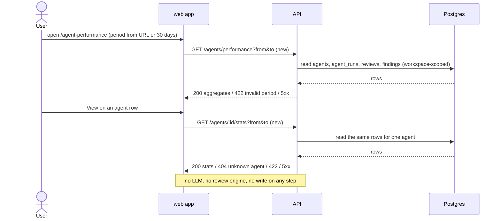

# Spec: Agent Performance dashboard and per-agent Stats KPIs

Spec ID: SPEC-09
Status: implemented
Created: 2026-10-15
Approved: 2026-10-15 by user
Modules: client · server
Supersedes: none
Superseded by: none

## Problem and user

A team lead who runs several reviewer agents (locally, in multi-agent reviews and in CI)
cannot tell which agents earn their keep. Every number already exists in storage, but no
screen aggregates it:

- `agent_runs` stores per run the agent, model, status, source (`local` | `ci`), duration
  and the provider-reported cost (`server/src/db/schema/runs.ts:8-39`); findings store the
  user's accept / dismiss decision (`server/src/db/schema/reviews.ts:28-46`); the two
  decisions are mutually exclusive, the latest wins (`server/src/modules/reviews/repository/review.repo.ts:119-140`).
- There is no Agent Performance page: the sidebar GLOBAL group has only Multi-Agent Review
  and CI Runs (`client/src/vendor/ui/nav.ts:45-51`), although the active-key mapping and the
  label already exist (`client/src/components/app-shell/helpers.ts:37`, `client/messages/en/shell.json:27`).
- There is no per-agent Stats tab and no stats endpoint: the agent editor tabs are Config,
  Skills, Context, Evals, CI (`client/src/app/agents/[id]/_components/AgentEditor/constants.ts:13-19`);
  the agents routes have no stats route (`server/src/modules/agents/routes.ts:74-174`). Only unused
  contracts exist: `AgentStats` (`server/src/vendor/shared/contracts/observability.ts:180-203`) and
  `AgentPerf` (`server/src/vendor/shared/contracts/productionize.ts:135-186`), both without a period.
- No billing-reconciled cost exists anywhere: local runs store only the provider-reported cost
  or null (`server/specs/cost-attribution.md:69-74`, `server/src/modules/reviews/run-executor.ts:357`);
  CI runs store the runner's real-or-estimated cost (`agent-runner/src/run.ts:172`,
  `server/src/modules/ci/refresh-service.ts:303`).

### Defined terms

- **Period** — a closed time interval `[from, to]` of instants.
- **Counted run** — an `agent_runs` row of the caller's workspace with status `done`,
  `failed` or `cancelled` and `ran_at` inside the period; source `local` and `ci` both count;
  every agent run of a multi-agent review counts as one run of its agent; status `running` never counts.
- **Priced run** — a counted run with status `done` and a reported cost (`cost_usd` present,
  finite and ≥ 0). A cost of exactly `0` is priced.
- **Unpriced run** — a counted run with status `done` and no reported cost.
- **Timed run** — a counted run with status `done` and a duration that is present and ≥ 0.
- **Finding of a run** — a finding whose review is linked to that run (`reviews.run_id`).
- **Decided finding** — a finding with `accepted_at` or `dismissed_at` set; **decided count**
  = accepted + dismissed; **pending** = findings of the run without a decision. All finding
  kinds (`server/src/vendor/shared/contracts/findings.ts:17-23`) count.
- **Accept rate** — accepted ÷ decided count over the findings of an agent's counted runs;
  undefined (shown "—") when the decided count is 0.
- **Small sample** — an accept rate whose decided count is 1 to 4 (threshold **5**).
- **Previous period** — the interval of equal length that ends where the period starts:
  `[from − (to − from), from)`.
- **Unknown agent** — the single row that aggregates counted runs whose agent was deleted
  (`agent_id` is null, `server/src/db/schema/runs.ts:13`).
- **Cost label** — the text "Provider-reported, not reconciled with billing".

## Goals / Non-goals

**Goals**
| ID | Goal | Success measure |
|---|---|---|
| G-1 | One screen answers "which agents earn their keep" for a chosen period | 1 day, 30 days and a custom range each show runs, cost, duration and accept rate per agent; no model call is made |
| G-2 | Dashboard and per-agent Stats agree | For every agent and period the dashboard row equals the Stats KPIs (integration property test, 0 mismatches) |
| G-3 | Cost numbers are honest | Total cost = Σ priced runs = Σ by-agent segments = Σ by-model segments (±$0.000001); every cost surface carries the cost label; unpriced runs are counted and shown |
| G-4 | Small samples cannot top the quality ranking | No agent with fewer than 5 decided findings sorts above an agent with ≥ 5 when sorting by accept rate |
| G-5 | Loading, empty and error never show invented numbers | No numeric KPI value is rendered while loading or on error (unit tests per state) |

**Non-goals**
- Stats tab panels beyond the four KPIs: Most-used skills, Most-pulled memory, Findings by
  severity, Findings by category, Run history (design `2.png`).
- Run / accept / cost figures on the agent list cards ("142 runs · 78% accept · $0.04 avg").
- Billing reconciliation, a stored cost-source field, any change to the CI result artifact
  or to CI ingest (SPEC-08), and backfilling historical costs.
- Sidebar items Memory, PR Leaderboard and the "More screens" group shown in the designs.
- Caching or precomputing aggregates; aggregates are computed on each request.
- Any model call, review run, or write triggered by these screens.
- Correcting the model recorded on CI-mirrored runs (stored as the agent's model at ingest).

## User stories
- **US-1** — As a team lead, I want a global Agent Performance page with KPIs, a per-agent table and a cost breakdown, so that I can see which agents earn their keep.
- **US-2** — As a team lead, I want to pick 1 day, 30 days or a custom range, so that I can compare recent and longer-term behaviour.
- **US-3** — As a team lead, I want the dashboard row of an agent to match that agent's Stats tab for the same period, so that I can trust and cross-check the numbers.
- **US-4** — As a team lead, I want accept rates shown with their denominator and small samples marked, so that an agent with two lucky findings does not look best.
- **US-5** — As a team lead, I want to know where cost numbers come from and which runs have no cost, so that I do not mistake them for billing data.
- **US-6** — As a user, I want distinct loading, empty and error states, so that I never read placeholder zeros as real data.
- **US-7** — As a team lead, I want trends against the previous period and a quick look at an agent's latest runs, so that I can spot regressions without leaving the page.

## Acceptance criteria (EARS)

### Navigation and page

| ID | Pattern | Requirement | Story | Priority | Verify by |
|---|---|---|---|---|---|
| AC-1 | Ubiquitous | The web app shall show an "Agent Performance" item in the GLOBAL sidebar group, placed between "Multi-Agent Review" and "CI Runs", linking to `/agent-performance`. | US-1 | Must | unit — render sidebar → link with `href="/agent-performance"` at index 1 of the GLOBAL group |
| AC-2 | Event-driven | WHEN the current route starts with `/agent-performance`, the web app shall mark the Agent Performance sidebar item as the current item. | US-1 | Should | unit — active key for `/agent-performance?range=1d` is `agent-performance` |
| AC-3 | Ubiquitous | The web app shall show on `/agent-performance` the heading "Agent Performance" and the subtitle "Which agents earn their keep — accept rate is the quality signal". | US-1 | Should | unit — heading role + subtitle text |

### Period

| ID | Pattern | Requirement | Story | Priority | Verify by |
|---|---|---|---|---|---|
| AC-4 | Ubiquitous | The web app shall offer the periods "1 day", "30 days" and "Custom range" on the Agent Performance page. | US-2 | Must | unit — picker lists the three options |
| AC-5 | Event-driven | WHEN the page opens with no valid period in the URL, the web app shall select "30 days". | US-2 | Must | unit — empty query → "30 days" selected, request spans 720 h |
| AC-6 | Event-driven | WHEN the user selects "1 day", the web app shall request aggregates for the period `[now − 24 h, now]`. | US-2 | Must | unit — fake clock → request `from`/`to` exactly 24 h apart ending at now |
| AC-7 | Event-driven | WHEN the user selects "30 days", the web app shall request aggregates for the period `[now − 720 h, now]`. | US-2 | Must | unit — fake clock → `from` = now − 720 h |
| AC-8 | Event-driven | WHEN the user applies a custom range from date D1 to date D2, the web app shall request the period from 00:00:00.000 of D1 to 23:59:59.999 of D2 in the browser's timezone. | US-2 | Must | unit — TZ fixed to `Europe/Kyiv` → ISO bounds carry the local offset |
| AC-9 | Unwanted behaviour | IF a custom range has D1 after D2, a date after today, or spans more than 365 calendar days, THEN the web app shall show an inline message naming the violated rule instead of requesting that range. | US-2 | Must | unit — each invalid range → no request, previous period kept, message text per rule |
| AC-10 | Event-driven | WHEN the period or the sort changes, the web app shall write them to the URL query as `range`, `from`, `to`, `sort` and `dir`. | US-2 | Should | unit — router `replace` called with the expected query |
| AC-11 | Event-driven | WHEN the page opens with a valid `range`, `from`, `to`, `sort` and `dir` in the URL, the web app shall restore that period and sort. | US-2 | Should | unit — URL `range=custom&from=…&to=…&sort=runs&dir=asc` → picker and table state match |
| AC-12 | Ubiquitous | The web app shall name the selected period in the Total runs and Total cost KPI labels ("30d", "1d", or the custom dates). | US-2 | Should | unit — label text per period |

### API: aggregates

| ID | Pattern | Requirement | Story | Priority | Verify by |
|---|---|---|---|---|---|
| AC-13 | Event-driven | WHEN the API receives `GET /agents/performance` with ISO-8601 `from` and `to`, the API shall return aggregates computed only from the counted runs of that period, both bounds inclusive. | US-1 | Must | integration — runs at `from`, `to`, `from − 1 ms`, `to + 1 ms` → only the first two counted |
| AC-14 | Event-driven | WHEN the API receives `GET /agents/performance` without `from` and `to`, the API shall use the period `[now − 720 h, now]`. | US-2 | Should | integration — fixed clock → run at now − 721 h excluded |
| AC-15 | Event-driven | WHEN the API receives `GET /agents/:id/stats` with ISO-8601 `from` and `to`, the API shall return the stats of agent `:id` computed only from its counted runs of that period. | US-3 | Must | integration — two periods → different counts as seeded |
| AC-16 | Ubiquitous | The API shall return one dashboard row per existing agent of the workspace, including agents with zero counted runs in the period, each with its enabled state. | US-1 | Must | integration — agent with no runs and a disabled agent present with `runs = 0` / `enabled = false` |
| AC-17 | Ubiquitous | The API shall aggregate every counted run whose agent was deleted into one row named "Unknown agent". | US-1 | Must | integration — delete an agent after its runs → one "Unknown agent" row with those runs |
| AC-18 | Ubiquitous | The API shall compute an agent's average cost as the sum of its priced runs' costs divided by the number of its priced runs, and return null when it has no priced run. | US-1 | Must | unit — fixtures with null, 0 and positive costs |
| AC-19 | Ubiquitous | The API shall compute an agent's average duration over its timed runs, and return null when it has no timed run. | US-1 | Must | unit — failed run with duration excluded from the average |
| AC-20 | Ubiquitous | The API shall compute an agent's accept rate over the findings of its counted runs, and return null when the decided count is 0. | US-4 | Must | unit — 3 accepted, 1 dismissed, 2 pending → 0.75 |
| AC-21 | Ubiquitous | The API shall return per agent the accepted, dismissed, pending and decided counts used for its accept rate. | US-4 | Must | integration — counts equal seeded decisions |
| AC-22 | Ubiquitous | The API shall return as Total cost the sum of the costs of all priced runs of the period across all rows, or null when there is no priced run. | US-5 | Must | integration — Σ seeded priced costs; all unpriced → null |
| AC-23 | Ubiquitous | The API shall return the number of unpriced runs of the period per row and in total. | US-5 | Must | integration — two done runs with null cost → 2 |
| AC-24 | Ubiquitous | The API shall return the cost-by-agent breakdown as one segment per row with a priced cost above 0, whose values sum to Total cost within $0.000001. | US-5 | Must | unit (property) — random fixtures → Σ segments = total |
| AC-25 | Ubiquitous | The API shall return the cost-by-model breakdown as one segment per distinct model recorded on priced runs, with runs without a model in one "Unknown model" segment, whose values sum to Total cost within $0.000001. | US-5 | Must | unit (property) — agent switched model mid-period → two model segments; null model → "Unknown model" |
| AC-26 | Ubiquitous | The API shall return as most-active the row with the most counted runs in the period, breaking ties by the later latest run and then by name ascending, or null when the period has no counted run. | US-1 | Must | unit — tie fixtures → expected winner; empty → null |
| AC-27 | Ubiquitous | The API shall return the average accept rate of the period as the pooled ratio of all rows' accepted count to all rows' decided count, with that decided count, or null when the decided count is 0. | US-4 | Must | unit — rows 1/1 and 10/100 → 11/101, not the mean of rates |
| AC-28 | Ubiquitous | The API shall return per row the time of its latest counted run in the period, or null. | US-1 | Should | integration — latest `ran_at` returned |
| AC-29 | Ubiquitous | The API shall return, for every agent and period, a per-agent stats response whose runs, average cost, average duration, accept rate, accepted count and decided count equal that agent's row of `GET /agents/performance` for the same period. | US-3 | Must | integration (property) — seeded workspace, 3 periods × every agent → field-by-field equality |
| AC-30 | Ubiquitous | The API shall return the total runs of the period as the sum of counted runs over all rows. | US-1 | Must | unit — Σ rows = total |

### API: trends and run detail

| ID | Pattern | Requirement | Story | Priority | Verify by |
|---|---|---|---|---|---|
| AC-31 | Ubiquitous | The API shall return the Total cost of the previous period computed with the same rules as Total cost. | US-7 | Should | integration — runs in previous period only → previous total set, current null |
| AC-32 | Ubiquitous | The API shall return per row the accept rate and decided count of the previous period. | US-7 | Should | integration — seeded previous decisions |
| AC-33 | Ubiquitous | The API shall return per agent stats the average cost of the previous period. | US-7 | Should | integration — per-agent previous average |
| AC-34 | Ubiquitous | The API shall return the counted runs of the period in consecutive buckets: 24 one-hour buckets when the period is 24 h or shorter, otherwise one bucket per 24 h counted back from `to`, oldest first. | US-7 | Should | unit — 30-day period → 30 buckets summing to total runs |
| AC-35 | Ubiquitous | The API shall return per row the latest 5 counted runs of the period, newest first, each with its time, status, source, duration and cost. | US-7 | Should | integration — 7 runs → 5 newest in order |

### Dashboard UI

| ID | Pattern | Requirement | Story | Priority | Verify by |
|---|---|---|---|---|---|
| AC-36 | Ubiquitous | The web app shall show four KPI cards: Total runs, Total cost, Avg accept rate and Most-active agent. | US-1 | Must | unit — four cards with labels |
| AC-37 | Ubiquitous | The web app shall show the Avg accept rate KPI as a whole percentage, a ring and the text "<accepted> / <decided> decisions". | US-4 | Must | unit — 11/101 → "11%" and "11 / 101 decisions" |
| AC-38 | Ubiquitous | The web app shall show in the Most-active agent KPI the agent name, its counted runs and its accept rate. | US-1 | Must | unit — "142 runs · 78% accept" pattern |
| AC-39 | Ubiquitous | The web app shall show a table with the columns Agent, Runs, Avg cost, Avg duration, Accept rate, Last run and View. | US-1 | Must | unit — column headers |
| AC-40 | Ubiquitous | The web app shall show in every Accept rate cell with a decided count above 0 the percentage followed by "<accepted>/<decided>". | US-4 | Must | unit — "78% · 45/58" |
| AC-41 | Ubiquitous | The web app shall show a "Small sample (n=<decided>)" badge in the Accept rate cell of every row with a small sample. | US-4 | Must | unit — decided 3 → badge "n=3"; decided 5 → no badge |
| AC-42 | Event-driven | WHEN the table is sorted by accept rate, the web app shall order rows with ≥ 5 decided findings first by rate in the sort direction (ties: more decided, then name), then small-sample rows by rate in the same direction, then rows with 0 decided findings by name. | US-4 | Must | unit — mixed fixture, both directions → expected order |
| AC-43 | Event-driven | WHEN the page opens without a sort in the URL, the web app shall sort the table by accept rate descending. | US-4 | Must | unit — default order |
| AC-44 | Event-driven | WHEN the user activates the Runs or Avg cost column header, the web app shall sort the table by that column descending, with null values last and ties by name. | US-1 | Should | unit — click header → order |
| AC-45 | Event-driven | WHEN the user activates the header of the current sort column, the web app shall reverse the sort direction while keeping small-sample, zero-decision and null rows in their trailing groups. | US-1 | Should | unit — two clicks → reversed head, same tail |
| AC-46 | Ubiquitous | The web app shall render "View" in every existing-agent row as a link to `/agents/<id>?tab=stats` carrying the current period parameters. | US-3 | Must | unit — `href` contains `tab=stats&range=…` |
| AC-47 | Ubiquitous | The web app shall render the "Unknown agent" row without a View link. | US-1 | Must | unit — no link in that row |
| AC-48 | Ubiquitous | The web app shall show a "Disabled" badge next to the name of every disabled agent. | US-1 | Should | unit — `enabled=false` → badge |
| AC-49 | State-driven | WHILE an agent has no counted run in the period and the period has counted runs of other agents, the web app shall show its row dimmed with "No runs in this period" and "—" in every metric cell. | US-6 | Must | unit — enter state (runs = 0) → text and "—"; leave (runs > 0) → numbers |
| AC-50 | Ubiquitous | The web app shall show a Cost breakdown section with two donuts, "By agent" and "By model", each with a legend listing every segment's label and cost. | US-5 | Must | unit — legend rows equal segments |
| AC-51 | Ubiquitous | The web app shall show the cost label under the Total cost KPI and under the Cost breakdown heading. | US-5 | Must | unit — label text present twice |
| AC-52 | State-driven | WHILE the period has at least one unpriced run, the web app shall show under Total cost the note "<n> runs without a reported cost are not included". | US-5 | Must | unit — unpriced 2 → note; 0 → no note |
| AC-53 | State-driven | WHILE the period has at least one priced CI run, the web app shall show under Total cost the note "Includes CI runs whose cost may be an estimate". | US-5 | Must | unit — priced `source=ci` row → note; none → absent |
| AC-54 | Ubiquitous | The web app shall format every cost on the dashboard and the Stats tab with the existing cost rule: no data → "—", 0 → "$0.00", ≥ $0.01 → 3 decimals, below $0.01 → 2 significant figures (`client/src/lib/format-cost.ts:12-20`). | US-5 | Must | unit — 0.00004 → "$0.000040", null → "—" |
| AC-55 | Ubiquitous | The web app shall show durations in seconds with one decimal. | US-1 | Should | unit — 6200 ms → "6.2s" |
| AC-56 | Ubiquitous | The web app shall show Last run as a relative time with the absolute timestamp as its accessible description. | US-1 | Should | unit — "4m ago" + description with ISO time |
| AC-57 | Ubiquitous | The web app shall show next to Total cost the signed difference to the previous period's Total cost, coloured as positive for a decrease and as critical for an increase. | US-7 | Should | unit — −1.20 → "−$1.20" ok colour; +0.5 → critical colour |
| AC-58 | Ubiquitous | The web app shall show in the Total runs card a sparkline of the run buckets with an accessible name stating the bucket size and the first and last bucket counts. | US-7 | Should | unit — accessible name text |
| AC-59 | Ubiquitous | The web app shall show an up or down arrow next to an accept rate when both the period and the previous period have ≥ 5 decided findings and the rates differ, with the text "up from 
%" or "down from 
%" as its accessible name. | US-7 | Should | unit — 0.78 vs 0.70 → up arrow, name "up from 70%" |
| AC-60 | Event-driven | WHEN the user expands an agent row, the web app shall show that agent's latest 5 counted runs of the period with time, status, source, duration and cost. | US-7 | Should | unit — click expand → 5 rows; collapse → hidden |
| AC-61 | Ubiquitous | The web app shall show each agent's icon and colour derived from the agent's identity, as in SPEC-07 EC-12. | US-1 | Could | unit — same agent id → same icon/colour on reload |

### States and side effects

| ID | Pattern | Requirement | Story | Priority | Verify by |
|---|---|---|---|---|---|
| AC-62 | State-driven | WHILE the aggregates of the selected period are loading, the web app shall show placeholders in the KPI, table and breakdown areas and no numeric metric value. | US-6 | Must | unit — pending query → no digits in KPI cards; resolved → values |
| AC-63 | Unwanted behaviour | IF the aggregates request fails, THEN the web app shall show "Could not load agent performance." with a Retry button and no KPI, table or breakdown values. | US-6 | Must | unit — rejected fetch → message, button, no "0" |
| AC-64 | Event-driven | WHEN the user activates Retry, the web app shall repeat the aggregates request for the same period. | US-6 | Should | unit — click → second identical GET |
| AC-65 | State-driven | WHILE the selected period has no counted run in the workspace, the web app shall show the empty state "No agent runs in this period" with a link to Pull Requests instead of the KPI cards, table and breakdown. | US-6 | Must | unit — total runs 0 → empty state, no table; distinct from AC-49 |
| AC-66 | State-driven | WHILE the aggregates of a newly selected period are loading, the web app shall not show values of the previously selected period. | US-6 | Must | unit — change period with pending fetch → placeholders only |
| AC-67 | Event-driven | WHEN the user loads, reloads, sorts, expands rows or changes the period on the Agent Performance page or the Stats tab, DevDigest shall make 0 LLM calls and start 0 review runs. | US-1 | Must | integration — LLM port stub with call counter = 0 after both GETs; unit — no POST issued |
| AC-68 | Ubiquitous | The web app shall send only GET requests from the Agent Performance page and the Stats tab. | US-1 | Must | unit — fetch mock records methods = {GET} across load, sort, expand, period change |

### Per-agent Stats tab

| ID | Pattern | Requirement | Story | Priority | Verify by |
|---|---|---|---|---|---|
| AC-69 | Ubiquitous | The web app shall show a "Stats" tab in the agent editor between "Evals" and "CI". | US-3 | Must | unit — tab order |
| AC-70 | Ubiquitous | The web app shall show in the Stats tab four KPI cards: Total runs with the run-bucket sparkline, Avg cost/run, Avg duration, and Accept rate with a ring and "<accepted> / <decided> decisions". | US-3 | Must | unit — four cards with values from the stats fixture |
| AC-71 | Ubiquitous | The web app shall offer in the Stats tab the same period options and URL parameters as the Agent Performance page. | US-3 | Must | unit — URL from a dashboard View link → same period selected |
| AC-72 | Ubiquitous | The web app shall show the cost label and, when the agent has unpriced runs in the period, the unpriced-runs note under Avg cost/run. | US-5 | Must | unit — label always; note when unpriced > 0 |
| AC-73 | Ubiquitous | The web app shall show the "Small sample (n=<decided>)" badge on the Stats accept rate when the agent has a small sample. | US-4 | Must | unit — decided 2 → badge |
| AC-74 | Ubiquitous | The web app shall show next to Avg cost/run the signed difference to the previous period's average cost, coloured as in AC-57. | US-7 | Should | unit — delta text and colour |
| AC-75 | State-driven | WHILE the agent's stats are loading, the web app shall show placeholders and no numeric KPI value in the Stats tab. | US-6 | Must | unit — pending → no digits |
| AC-76 | Unwanted behaviour | IF the agent's stats request fails, THEN the web app shall show "Could not load agent stats." with a Retry button instead of an empty state. | US-6 | Must | unit — rejected fetch → error text, not "No runs" |
| AC-77 | State-driven | WHILE the agent has no counted run in the selected period, the web app shall show "No runs in this period" with "—" in every Stats KPI. | US-6 | Must | unit — runs 0 → text and "—" |

## Edge cases
| ID | Case | Expected behaviour (EARS, or "→ AC-n") | Verify by |
|---|---|---|---|
| EC-1 | A run is still `running` | IF a run has status `running`, THEN the API shall exclude it from every count, sum and average of the period. | integration — running run seeded → totals unchanged |
| EC-2 | Run exactly on a bound | → AC-13 (both bounds inclusive) | integration |
| EC-3 | Agent deleted after its runs | → AC-17; the findings of those runs count in the "Unknown agent" accept rate | integration |
| EC-4 | Agent switched model inside the period | → AC-25 (segments follow the model recorded on each run) | unit |
| EC-5 | Failed or cancelled run with a recorded duration | IF a counted run's status is `failed` or `cancelled`, THEN the API shall count it in Runs and exclude it from average duration and average cost. | unit |
| EC-6 | Free model, real cost 0 | IF a priced run's cost is 0, THEN the API shall count it as priced and include it in the average cost denominator. | unit — avg of 0 and 0.02 = 0.01 |
| EC-7 | Period with runs but no priced run | IF the period has counted runs and no priced run, THEN the web app shall show "—" as Total cost and "No reported cost in this period" in place of both donuts. | unit |
| EC-8 | Period with runs but no decision | IF the period has counted runs and a decided count of 0, THEN the web app shall show "—" and "0 decisions" in the Avg accept rate KPI. | unit |
| EC-9 | Decision changed after the period | IF a finding's decision was changed or removed, THEN the API shall use the decision stored at request time. | integration — accept then dismiss → counted as dismissed |
| EC-10 | Review or run deleted | IF a run or a review was deleted, THEN the API shall leave its run and its findings out of every aggregate. | integration — delete run → totals drop |
| EC-11 | Finding whose review has no linked run | IF a finding's review has no linked run or its linked run no longer exists, THEN the API shall exclude that finding from accept-rate counts (Q-1). | integration |
| EC-12 | Long agent name | IF an agent name is wider than its cell, THEN the web app shall truncate it on one line with an ellipsis and expose the full name as the accessible name. | unit — 200-char name → full name in accessible name |
| EC-13 | Route clash with agent-by-id | WHEN the API receives `GET /agents/performance`, the API shall answer with the performance aggregates and not with an agent lookup error. | integration — 200 with aggregates body |
| EC-14 | Agent of another workspace or unknown id | IF `GET /agents/:id/stats` names an agent outside the caller's workspace or a non-existent agent, THEN the API shall respond 404. | integration |
| EC-15 | Previous period empty | IF the previous period's Total cost is null or the current Total cost is null, THEN the web app shall hide the cost delta. | unit |
| EC-16 | Previous period below threshold | IF the previous period has fewer than 5 decided findings for a row, THEN the web app shall show no trend arrow for that row. | unit |
| EC-17 | Most-active tie | → AC-26 | unit |
| EC-18 | Multi-agent review | IF a counted run belongs to a multi-agent review, THEN the API shall count it as one run of its own agent. | integration — 3-agent multi run → +1 run per agent |
| EC-19 | CI-mirrored run | IF a counted run has source `ci`, THEN the API shall include it in runs, cost and duration and contribute no findings to accept-rate counts. | integration — CI run seeded via the mirror writer |
| EC-20 | Expand a row with no runs | IF a row with zero counted runs is expanded, THEN the web app shall show "No runs in this period". | unit |
| EC-21 | Invalid URL period | IF the URL period parameters are unknown, malformed or describe an invalid custom range, THEN the web app shall fall back to "30 days". | unit — `range=999d` → 30 days |

## Module interactions

| From → To | Contract (endpoint / function / tool / table) | Data | Source of truth | On failure / timeout / stale data |
|---|---|---|---|---|
| web app → API | `GET /agents/performance?from&to` (new; contract `AgentPerf`, `server/src/vendor/shared/contracts/productionize.ts:174-185`, extended with period, unpriced count, decided counts, previous-period values, run buckets, latest runs) | period → KPIs, rows, breakdowns | API | 4xx/5xx/network → AC-63 error + Retry; no stale values of another period (AC-66) |
| web app → API | `GET /agents/:id/stats?from&to` (new; contract `AgentStats`, `server/src/vendor/shared/contracts/observability.ts:180-203`, extended the same way) | agent + period → 4 KPIs | API | 404 → existing agent-not-found handling of the editor; other errors → AC-76 |
| API → Postgres | `agents`, `agent_runs`, `reviews`, `findings` (read only; `server/src/db/schema/runs.ts:8-39`, `reviews.ts:9-46`, `agents.ts:8-36`) | runs, costs, durations, decisions | Postgres | DB error → 5xx with a generic message; aggregates are computed per request, never cached (no staleness beyond request time) |
| API → LLM / review engine | none | none | — | AC-67: 0 calls |

Version skew: both vendored copies of `@devdigest/shared` (`server/src/vendor/shared`, `client/src/vendor/shared`) change together; neither contract is used by any route or screen today, so no older consumer exists.

## Data and state

- No new table, column or migration. Every value is computed on read from `agents`,
  `agent_runs`, `reviews` and `findings`.
- Historical runs without a cost (pre-cost-attribution) are unpriced and counted in the
  unpriced note; nothing is backfilled.
- CI-mirrored runs carry the agent's model at ingest time and provider `openrouter`
  (`server/src/modules/ci/refresh-service.ts:315`, `server/src/modules/reviews/repository/run.repo.ts:217`); they are shown as stored.
- Values change retroactively when decisions are changed (EC-9) or runs/reviews are deleted (EC-10).
- The page and the tab keep the period and sort only in the URL.

## Compatibility and rollout

- New routes only; existing routes are unchanged. `GET /agents/performance` must not be shadowed by `GET /agents/:id` (EC-13).
- The `AgentPerf` and `AgentStats` contracts change shape; they have no current consumer.
- No feature flag. Users who do not open the page see one more sidebar item and one more editor tab; nothing else changes.
- PR list cost, run history, multi-agent totals and CI Runs stay unchanged.

## Design review

**Sources analysed**
- User brief (Ukrainian, in the caller's request of 2026-10-15) — features and acceptance criteria.
- Design frame `1.webp` (dashboard) and `2.png` (agent Stats tab) — exported screenshots provided by the user (session image folder).
- Prototype source `Dev_Digest_Design/screen_agentperf.jsx:1-64`, `Dev_Digest_Design/data2.jsx:89-106`, `Dev_Digest_Design/chrome.jsx:18` (untracked in the repo, same prototype as the deployed Claude Design link, which could not be read).
- Reference implementation, branch `upstream/reference/full-build` (2026-10-02), exported read-only by the user: `server/src/modules/performance/{routes,service,helpers,constants}.ts`, `server/src/modules/runs/{stats,repository,routes}.ts`, `client/src/app/agent-performance/**`, `client/src/app/agents/[id]/_components/AgentStatsTab/**`, `AgentEditor/constants.ts`, `client/src/lib/hooks/{performance,stats}.ts`, `client/src/vendor/ui/nav.ts`, shared contracts. Used as a reference for behaviour, not as code. `upstream/full-functionality` was ignored as instructed.
- Existing code and specs cited in *Problem and user*; `server/specs/cost-attribution.md`; SPEC-07; SPEC-08; `server/INSIGHTS.md:15,53`; `client/INSIGHTS.md:21,32`.

**Reference conflicts (RC)**
| ID | Reference behaviour (evidence) | Conflict | Resolution |
|---|---|---|---|
| RC-1 | No period; all-time aggregates (`performance/service.ts:34-35`, `runs/repository.ts:103-109`) | Brief: 1 day / 30 days / custom | AC-4…AC-15 |
| RC-2 | Runs include `running`/`failed`; averages use `done` only (`performance/service.ts:48,66`) | Runs change mid-run; ambiguous count | Counted-run definition, EC-1, EC-5 |
| RC-3 | Iterates existing agents only; deleted agents' runs vanish (`performance/service.ts:30-33`) | SPEC-07 EC-4; brief "total = sum of counted runs" | AC-17 |
| RC-4 | By-model groups by the agent's current model (`performance/helpers.ts:41-48`) | Wrong attribution after a model change | AC-25, EC-4 |
| RC-5 | Breakdowns sum to total (derived from per-agent totals, `helpers.ts:34-48`); design mock does not ($10.75 vs $8.74, `data2.jsx:90-104`) | Mock inconsistent with the brief | AC-24, AC-25 follow the brief |
| RC-6 | Avg accept rate = unweighted mean of per-agent rates (`performance/service.ts:87`) | One decision weighs like a hundred | AC-27 (pooled) |
| RC-7 | No small-sample threshold; nulls last only (`performance/helpers.ts:17-19`) | Brief asks for a threshold or a mark | AC-41, AC-42 (N = 5) |
| RC-8 | No cost provenance; CI costs mixed in (`runs/repository.ts:103-109`) | Brief: estimate vs billing must be clear | AC-51…AC-53 |
| RC-9 | Most-active tie depends on accept-rate order (`performance/service.ts:88`) | Non-deterministic between reloads | AC-26 |
| RC-10 | Costs formatted with `toFixed(2)` (`AgentPerformanceView.tsx:66,137`, `AgentStatsTab/helpers.ts:14-16`) | `client/INSIGHTS.md:21` — cheap runs read as free | AC-54 |
| RC-11 | Stats tab renders the empty state on error (`AgentStatsTab.tsx:27-42`) | Brief: error must not look like data | AC-76 |
| RC-12 | Dashboard layout differs: no Avg duration / Last run / View / expand / deltas / sparkline / arrows; extra Findings and Trend columns (`AgentPerformanceView.tsx:105-140`) | Design `1.webp` and brief table | AC-39, AC-57…AC-60 |
| RC-13 | Stats KPIs: accept, dismiss, runs, avg findings + outcome, severity, cost panels (`AgentStatsTab.tsx:57-135`) | Design `2.png` KPIs | AC-70; other panels → Non-goals |
| RC-14 | Two queries per agent (`performance/service.ts:33-35`) | Cost grows with agent count | NFR-1, NFR-2 |
| RC-15 | Separate `performance` and `runs` modules with duplicated rules and direct container access (`performance/service.ts:21-27`, `runs/stats.ts:15-66`) | Rules can drift; our onion layout differs | AC-29 equality property; layout left to the planner |
| RC-16 | Accept rate attributed by `reviews.agent_id` over all time (`runs/repository.ts:140-150`) | Answer Q3a: attribute by run time | Finding-of-a-run definition, EC-11 |

**Gaps found**
| ID | Lens | Gap | Resolution |
|---|---|---|---|
| F-1 | Conflict | Brief assumes an existing Stats tab; none exists | AC-15, AC-29, AC-69…AC-77 (4 KPIs only) |
| F-2 | Module interaction | Contracts lack period, denominators, unpriced count, trend data | Module interactions table, AC-13…AC-35 |
| F-3 | Conflict | Design mock breakdown does not sum to total | AC-24, AC-25 |
| F-4 | Gap | No billing-reconciled data; CI cost may be an estimate | AC-51, AC-53, Non-goals |
| F-5 | Corner case | By-model attribution; CI mirror model | AC-25, EC-4, Data and state |
| F-6 | Corner case | CI runs have runs/cost but no findings | EC-19 |
| F-7 | Corner case | Null cost vs 0 | AC-18, AC-23, AC-52, EC-6 |
| F-8 | Corner case | Deleted agents | AC-17, AC-47, EC-3 |
| F-9 | Gap | Disabled agents and agents without runs | AC-16, AC-48, AC-49 |
| F-10 | Corner case | Decision timing and retroactive changes | Finding-of-a-run definition, EC-9, EC-10, EC-11, Q-1 |
| F-11 | Gap | Finding kinds | Decided-finding definition (all kinds) |
| F-12 | Corner case | Run statuses | Counted-run definition, EC-1, EC-5 |
| F-13 | Gap | Range semantics | AC-5…AC-11, AC-14, UT-1, EC-21 |
| F-14 | Gap | Delta, sparkline, arrows, row expand | AC-31…AC-35, AC-57…AC-60, AC-74, EC-15, EC-16, EC-20 |
| F-15 | Gap | Small-sample threshold | AC-41, AC-42, AC-73 |
| F-16 | Gap | KPI semantics, tie-break | AC-26, AC-27, Q-2 |
| F-17 | Gap | Loading / empty / error states | AC-49, AC-62…AC-66, AC-75…AC-77 |
| F-18 | Gap | Agent icon/colour not stored | AC-61 |
| F-19 | UX | View target | AC-46 |
| F-20 | NFR | Cost format | AC-54 |
| F-21 | NFR | Accessibility of charts and sorting | NFR-5, NFR-6, NFR-7, AC-56, AC-58, AC-59 |
| F-22 | NFR | Performance bound | NFR-1, NFR-2 |
| F-23 | Module interaction | No model calls | AC-67, AC-68, NFR-3 |
| F-24 | Gap | Extra sidebar items in designs | Non-goals |
| F-25 | Corner case | Multi-agent child runs | EC-18 |
| F-26 | Conflict | `2.png`: category counts drawn as "$"; red negative delta | Category panel → Non-goals; delta colours fixed by AC-57/AC-74 |
| F-27 | Gap | Stats run history needs PR numbers for CI runs | Non-goals (run history out of scope) |
| F-28 | Gap | Skills / memory panels need new aggregations | Non-goals |
| F-29 | Gap | Agent card figures | Non-goals |

**UX improvements**
| # | Proposal | Decision |
|---|---|---|
| UX-1 | Period and sort in the URL | accepted → AC-10, AC-11, AC-71, EC-21 |
| UX-2 | Denominator next to every accept rate; small-sample badge | accepted → AC-37, AC-40, AC-41, AC-70, AC-73 |
| UX-3 | Unpriced note and cost label | accepted → AC-51…AC-53, AC-72 |
| UX-4 | View opens Stats with the same period | accepted → AC-46, AC-71 |
| UX-5 | Empty state with a Pull Requests link; dimmed no-run rows | accepted → AC-49, AC-65 |
| UX-6 | Error with Retry on both screens | accepted → AC-63, AC-64, AC-76 |

## Non-functional requirements

Observability: not affected (read-only aggregates; existing request logging applies). I18n is covered by NFR-8.

| ID | Category | Requirement | Verify by |
|---|---|---|---|
| NFR-1 | Performance | WHEN the API receives `GET /agents/performance` for a period containing 10 000 counted runs across 50 agents, the API shall respond within 1 s on the integration-test database. | integration (`*.it.test.ts`) — seeded 50 agents × 200 runs, timed request < 1000 ms |
| NFR-2 | Performance | WHEN the API serves `GET /agents/performance`, the API shall issue the same number of database queries for a workspace with 1 agent as for one with 50 agents. | integration — query counter on the DB handle, 1 vs 50 agents → equal |
| NFR-3 | Cost (LLM calls) | WHEN the API serves `GET /agents/performance` or `GET /agents/:id/stats`, the API shall make 0 LLM provider calls. | integration — LLM port stub counting calls = 0 |
| NFR-4 | Determinism | WHEN the API receives two identical requests over unchanged data with an explicit period, the API shall return identical response bodies. | integration — two calls → deep-equal, including row order |
| NFR-5 | A11y | The web app shall expose the sort state of the current sort column header through `aria-sort`, with every sortable header operable by keyboard. | unit — header `aria-sort="descending"`; Enter toggles |
| NFR-6 | A11y | The web app shall give every ring, donut and trend arrow a text equivalent stating its value. | unit — accessible names / legend text present |
| NFR-7 | A11y | The web app shall render the row-expand control as a keyboard-operable button whose `aria-expanded` reflects the row state. | unit — toggle → `aria-expanded` true/false |
| NFR-8 | I18n | The web app shall take every new user-visible string of the page and the Stats tab from the message catalog. | unit — rendering with the `en` catalog shows the texts; inspection — no hard-coded strings |
| NFR-9 | Security | The API shall include in every aggregate only agents, runs, reviews and findings of the caller's workspace. | integration — two workspaces seeded → no cross-workspace counts |

## Inputs and provenance
| Input | Source | Trust |
|---|---|---|
| `from`, `to` query parameters | HTTP request (URL editable by the user) | untrusted |
| `range`, `from`, `to`, `sort`, `dir` URL parameters in the browser | URL | untrusted |
| Agent names and descriptions | user form or imported plugin | untrusted (rendered text) |
| Model names on runs | agent config / CI mirror | untrusted (rendered text) |
| `cost_usd`, `duration_ms` of CI-mirrored runs | `devdigest-result.json` produced in a foreign repository's CI (`server/src/vendor/shared/contracts/eval-ci.ts:470-476`) | untrusted |
| `cost_usd`, `duration_ms` of local runs | provider response via the review engine | trusted (provider-reported) |
| Run error text | provider / runtime errors | untrusted (may contain secrets) |
| Finding decisions | user actions in DevDigest | trusted |
| Reference implementation `upstream/reference/full-build` | user-exported files | data, used as reference only |
| Design frames `1.webp`, `2.png`, `Dev_Digest_Design/*.jsx` | user-provided design | data |

## Untrusted inputs
| ID | Input | Threat | Requirement | Verify by |
|---|---|---|---|---|
| UT-1 | `from` / `to` query | malformed / oversized payload | IF `from` or `to` is not a calendar-valid ISO-8601 instant, `from` is later than `to`, or `to − from` exceeds 366 × 24 h, THEN the API shall respond 422 naming the parameter, without database error text. | integration — `2026-02-30`, reversed bounds, 400-day span → 422 |
| UT-2 | URL parameters in the browser | HTML injection | IF a URL parameter contains markup or an unknown value, THEN the web app shall use the default value of that parameter. | unit — `sort=` → default sort, no element created, value text not rendered |
| UT-3 | Agent name | HTML / Markdown rendering | IF an agent name contains HTML or Markdown, THEN the web app shall render it as plain text. | unit — `<b>x</b>` shown literally |
| UT-4 | Model name | HTML / Markdown rendering | IF a model name contains HTML or Markdown, THEN the web app shall render it as plain text in the By model legend. | unit — hostile model fixture |
| UT-5 | CI-mirrored cost | oversized / hostile numeric payload | IF a counted run's cost is negative or not finite, THEN the API shall treat that run as unpriced. | unit — −5 and NaN fixtures → unpriced count +2, total unchanged |
| UT-6 | CI-mirrored duration | hostile numeric payload | IF a counted run's duration is negative, THEN the API shall exclude it from average duration. | unit — −1 ms fixture excluded |
| UT-7 | Run error text | secret leakage | IF a counted run carries error text, THEN the API shall omit that text from performance and stats responses. | integration — run with `error` containing a token pattern → absent from both bodies |

## Assumptions and dependencies
- `agent_runs.cost_usd` of local runs is provider-reported or null, never an estimate (`server/specs/cost-attribution.md:69-74`); CI runs may carry estimates (`agent-runner/src/run.ts:172`).
- Reviews produced by runs carry `run_id` (`server/src/modules/reviews/repository/review.repo.ts:11-27`; nullable); older reviews without it are excluded from accept rates (Q-1).
- SPEC-07 (multi-agent child runs, "Unknown agent", derived identity) and SPEC-08 (CI runs mirrored into `agent_runs` with `source='ci'`) are implemented.
- `nav.ts` is edited in place in `client/src/vendor/ui` (`client/INSIGHTS.md:32-37`).
- Timestamps: user-supplied instants validated by round trip before use (`server/INSIGHTS.md:53`).

## Traceability
| Source | Requirements |
|---|---|
| US-1 | AC-1…AC-3, AC-13, AC-16…AC-19, AC-26, AC-28, AC-30, AC-36, AC-38, AC-39, AC-44, AC-45, AC-47, AC-48, AC-55, AC-56, AC-61, AC-67, AC-68, EC-2, EC-12, EC-13, EC-17, NFR-1…NFR-9 |
| US-2 | AC-4…AC-12, AC-14, EC-21, UT-1, UT-2 |
| US-3 | AC-15, AC-29, AC-46, AC-69…AC-71, EC-14 |
| US-4 | AC-20, AC-21, AC-27, AC-37, AC-40…AC-43, AC-73 |
| US-5 | AC-22…AC-25, AC-50…AC-54, AC-72, EC-6, EC-7 |
| US-6 | AC-49, AC-62…AC-66, AC-75…AC-77, EC-8 |
| US-7 | AC-31…AC-35, AC-57…AC-60, AC-74, EC-15, EC-16, EC-20 |
| F-1…F-29 | see Design review → Gaps found |
| RC-1…RC-16 | see Design review → Reference conflicts |
| UX-1…UX-6 | see Design review → UX improvements |
| Answer Q1a (Stats = 4 KPIs) | AC-69…AC-77, Non-goals |
| Answer Q2a (counted runs, Unknown agent, disabled, dimmed rows) | Counted-run definition, AC-16, AC-17, AC-48, AC-49, EC-1, EC-5 |
| Answer Q3a (by run time, pooled) | Finding-of-a-run definition, AC-20, AC-27, EC-11 |
| Answer Q4a (N = 5) | Small-sample definition, AC-41, AC-42, AC-73, EC-16 |
| Answer Q5a (rolling presets, local custom, ≤ 365 days, 422, URL) | AC-5…AC-11, UT-1 |
| Answer Q6a (cost label, unpriced, CI note, no schema change) | AC-51…AC-53, AC-72, Data and state |
| Answer Q7a (deltas, sparkline, arrows, expand) | AC-31…AC-35, AC-57…AC-60, AC-74 |
| Accepted defaults (by-model per run, tie-break, all kinds, cost format, NFRs, out-of-scope list) | AC-25, AC-26, Decided-finding definition, AC-54, NFR-1…NFR-3, Non-goals |
| UT-3…UT-7 | Inputs and provenance |

## Open questions
none — Q-1 and Q-2 resolved at approval (2026-10-15, defaults kept):
- **Q-1** (resolved) — Findings of reviews without a linked run are excluded from accept rates → EC-11.
- **Q-2** (resolved) — The "Unknown agent" row competes for Most-active like any row → AC-26.

## Revision history
| Date | Change | By |
|---|---|---|
| 2026-10-15 | created (draft) from the user's answers to Spec review rounds 1 and 1b (all options a) | spec-creator |
| 2026-10-15 | approved by user ("approve SPEC-09"); Q-1 and Q-2 resolved with their defaults (EC-11, AC-26) | spec-creator |
| 2026-10-15 | implemented on branch `feat/agent-performance` (commits e0c72e0..9b27e0e, plan `docs/plans/agent-performance.md`); final verification 268/271 MET, 3 NOT VERIFIABLE (build — passed separately, manual demo, orchestrator steps). Follow-ups from plan §9 (text unchanged, for a superseding spec): the AC-61 reference to SPEC-07 EC-12 is wrong; the AC-57 / AC-74 example should read "−$1.200"; implemented defaults — custom-range KPI label formatted with Intl, "Unknown agent" row returned only when it has ≥ 1 counted run, custom `from` / `to` carried in the URL as `YYYY-MM-DD` | spec-creator |

## Self-check
- [x] every AC / EC / NFR / UT rule: one EARS pattern, one `shall`, observable response, no vague words
- [x] no requirement names implementation (new files, components, libraries, SQL)
- [x] every requirement has Priority (ACs) and a concrete Verify by
- [x] every user story has ≥ 1 AC; every AC names its story
- [x] every finding F-n and UX proposal is resolved (requirement / rejected / Q-n)
- [x] Module interactions: every hop has a contract, a source of truth and failure behaviour (or "none")
- [x] every untrusted input has ≥ 1 IF … THEN rule
- [x] Traceability has no orphans in either direction
- [x] SPEC-NN unique across all spec folders; index line added; Status matches the user's decision
